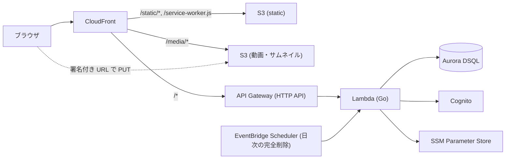
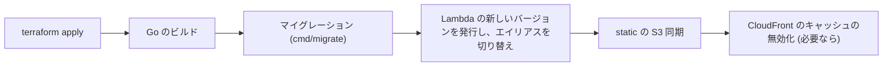

# family-video Architecture

[PRD](prd.md) の要件を、どう作るかの全体構成。細かい設計は下の文書、方式の理由は [ADR](adr/README.md) にある。

| 文書 | 内容 |
|---|---|
| [upload.md](specs/upload.md) | アップロード・再開 |
| [playback.md](specs/playback.md) | 一覧・再生・ダウンロード・お気に入り |
| [data.md](specs/data.md) | 保存する情報・削除・バックアップ・保存料 |
| [security.md](specs/security.md) | 認証・配信・権限・乱用対策 |
| [observability.md](specs/observability.md) | ログ・アラーム・通知 |
| [operations.md](specs/operations.md) | Runbook・手動の作業・テスト |

## Architecture

判断の理由: [ADR-0001](adr/0001-cloud-aws-serverless.md) / [ADR-0007](adr/0007-video-storage-delivery.md)

入り口は CloudFront の 1 つで、パスごとに S3 と API へ振り分ける (同一オリジンなので CORS は要らない)。アップロードだけは署名付き URL で S3 に直接送る。

- サーバーは Go で書いた Lambda 1 つ。画面の HTML も Lambda が組み立てて返す (`html/template` + htmx)。npm などのフロントエンドのビルドは使わない
- DB は Aurora DSQL

## Environments

判断の理由: [ADR-0008](adr/0008-iac-environments.md)

- 環境は `dev` と `prod` の 2 つ。同じ AWS アカウントに置き、リソース名・IAM ロール・GitHub Environment で分ける

## CI/CD

判断の理由: [ADR-0011](adr/0011-repository-ci.md)

GitHub Actions で、AWS へは OIDC で接続する。ロールは読み取り専用・`dev`・`prod` の 3 つで、長期のアクセスキーは発行しない。

| ワークフロー | きっかけ | 内容 |
|---|---|---|
| `ci.yml` (未作成) | PR | `go test`・`govulncheck`・`terraform plan` (読み取り専用) |
| `deploy.yml` (未作成) | main へのマージ / タグ (`v*`) | `dev` / `prod` へデプロイ (下の図) |
| `task.yml` (未作成) | 手動実行 | `cmd/task` ([Operations](specs/operations.md)) |

- `prod` は Environment の承認を通す。`prod` のロールはタグからの実行だけに限る
- キャッシュの無効化は、`service-worker.js` などの差し替えを反映するため、必要なら行う。ロールバックは、エイリアスを前のバージョンに戻す
- マイグレーションは、デプロイのジョブが Lambda の更新前に実行する。前のバージョンでも動く形で進める ([Data](specs/data.md))。DSQL は IAM 認証で接続できるので、マイグレーション用の Lambda は持たない
- 招待と復旧は Cognito のコンソールか CLI で、メンバーの除外と動画の復元は `cmd/task` で行う。管理用の Lambda は持たない
