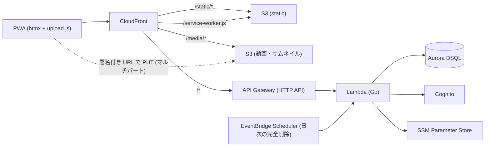

# family-video Architecture

[PRD](prd.md) の要件を、どう作るかの設計書。全体構成だけをここに書き、細かい設計は [specs/](#specs) に分ける。方式を選んだ理由は [ADR](adr/README.md) にある。

## Specs

| 文書 | 内容 |
|---|---|
| [upload.md](specs/upload.md) | アップロード・再開 |
| [playback.md](specs/playback.md) | 一覧・再生・ダウンロード・お気に入り |
| [data.md](specs/data.md) | 保存する情報・削除と完全削除・バックアップ・保存料の目安 |
| [security.md](specs/security.md) | 認証・配信・権限・乱用対策 |
| [observability.md](specs/observability.md) | ログ・アラーム・通知 |
| [operations.md](specs/operations.md) | Runbook・依存・テスト・性能・画面の方針 |

## Architecture

判断の理由: [ADR-0001](adr/0001-cloud-aws-serverless.md) / [ADR-0007](adr/0007-video-storage-delivery.md)

入り口は CloudFront の 1 つだけ。パスごとに S3 と API へ振り分けるので、ブラウザから見ると同一オリジンになり、CORS は要らない。動画のアップロードだけは、署名付き URL で S3 に直接送る。



### Routing

| パス | 振り分け先 | 備考 |
|---|---|---|
| `/static/*` | S3 | htmx・CSS・JS・manifest。OAC (CloudFront からだけ読める) |
| `/service-worker.js` | S3 | Service Worker。scope を `/` にするため、ルートのパスで配信する。`/static/*` と同じ S3 から返すビヘイビアを 1 つ足す |
| `/media/*` | S3 | 動画とサムネイル。OAC と署名付き URL |
| `/*` | API Gateway → Lambda | 画面 (html/template)・`/auth/*`・`/api/*` |

### Components

- Lambda は 1 つ。Go の zip を provided.al2023 で動かし、VPC には置かない。同じ Lambda を EventBridge Scheduler からも呼ぶ
- 画面は Go の `html/template` で作り、htmx で部分更新する。ビルド工程はなく、htmx は 2.0.11 に固定して `/static/` から配信する
- 状態は URL・サーバー・素の JS (アップロードだけ) に持たせる
- Go の外部依存は aws-lambda-go・aws-sdk-go-v2・pgx に限る
- DB は Aurora DSQL。使う SQL は基本的な CRUD に限り、アクセスは `internal/db` に集める
- Cognito が家族のアカウントと認証を担い、SSM Parameter Store が署名用の鍵とオリジン検証の値を持つ
- Lambda の実行時間は短い。動画のデータは Lambda を通らないので、メモリとタイムアウトは小さめにする (値は実装時に決める)

## Environments

判断の理由: [ADR-0008](adr/0008-iac-environments.md)

- 環境は `dev` と `prod` の 2 つだけ (staging は作らない)。同じ Terraform のコードから作り、違いは変数 (地域制限・ログレベルなど) だけにする
- `dev` と `prod` は同じ AWS アカウントに置き、リソース名・IAM ロール・GitHub Environment で分ける (#20)
- 状態ファイルは環境ごとに別のキーにし、`dev` の操作が `prod` に影響しないようにする
- 独自ドメインは使わない。URL は CloudFront の既定のものを使い、公開リポジトリには書かない (#19)
- アカウント ID やドメインなどの環境固有の値は、GitHub の Environment 変数から渡す。`*.tfstate` と `*.tfvars` はコミットしない
- Terraform 本体と AWS プロバイダーのバージョンは固定し、`.terraform.lock.hcl` をコミットする

## Deployment

| きっかけ | 内容 |
|---|---|
| PR | 読み取り専用のロールで `terraform plan`・`go test`・`govulncheck` を実行する |
| main へのマージ | `dev` に自動でデプロイする (`terraform apply` → Go のビルド → マイグレーション → Lambda の更新 → static の同期) |
| タグ (`v*`) | `prod` にデプロイする。`prod` のロールはタグからの実行だけに限定する |

- マイグレーションは、デプロイのジョブ (GitHub Actions) が OIDC のロールで、Lambda を更新する前に `cmd/migrate` を実行して行う。DSQL は VPC の外にあり IAM 認証で接続できるので、マイグレーション用の Lambda は持たない
- 管理の操作 (招待・除外・復旧) も Runbook に沿ってコンソールか CLI で行うので、管理用の Lambda は持たない
- Lambda はバージョンとエイリアスで管理する。デプロイに失敗したら、エイリアスを前のバージョンに戻す
- マイグレーションは前のバージョンのコードでも動く形で進める ([Data](specs/data.md))
- DSQL の制限はローカルの PostgreSQL では検出されないので、マイグレーションの SQL は `dev` の DSQL で確認する
- ローカル開発は `go run` とローカルの PostgreSQL (Docker) で行う。ローカルだけで使う仮のログインは、ビルドタグ `localdev` で用意し、AWS 上のバイナリには含めない

## Repository

判断の理由: [ADR-0011](adr/0011-repository-ci.md)

GitHub の public リポジトリで、モノレポにする。インフラとコードの変更を 1 つの PR で済ませる。

```text
family-video/
├─ infra/                      # Terraform (未作成)
│  ├─ bootstrap/               # 状態保存用 S3 バケットと GitHub OIDC ロール (最初に 1 回だけ)
│  ├─ main.tf  variables.tf  outputs.tf  versions.tf  backend.tf
│  ├─ envs/{dev,prod}.backend.hcl  # 環境ごとの状態ファイルのキー (値は CI から渡す)
│  └─ modules/{storage,cdn,api,auth,db}/
├─ app/                        # Go (未作成)
│  ├─ cmd/api/main.go          # Lambda 用とローカル用の起動を切り替える
│  ├─ cmd/migrate/main.go
│  ├─ cmd/task/                # 手動で実行する作業 (サブコマンド。入口は 1 つ)
│  ├─ internal/{auth,video,db,sign,web}/
│  ├─ templates/               # html/template (go:embed でバイナリに含める)
│  └─ migrations/
├─ static/                     # S3 の /static/* に同期 (未作成)
│  ├─ htmx.min.js              # 2.0.11 を固定して同梱
│  ├─ upload.js  app.css
│  └─ manifest.webmanifest  service-worker.js   # service-worker.js は CloudFront の /service-worker.js から配信する
├─ docs/
│  ├─ prd.md
│  ├─ architecture.md
│  ├─ specs/
│  ├─ adr/
│  └─ runbook/                 # (未作成)
├─ .github/
│  ├─ dependabot.yml
│  └─ workflows/
│     ├─ claude.yml            # @claude への応答 (既存)
│     └─ ci.yml  deploy.yml  task.yml    # (未作成。task.yml は手動実行の作業用)
├─ CLAUDE.md
├─ LICENSE                     # MIT
└─ README.md
```

### CI/CD

- GitHub Actions と OIDC を使う。`dev` と `prod` で GitHub Environment ごとに、OIDC のロールと変数を分ける
- 手動で実行する作業は、`task.yml` (workflow_dispatch) で `cmd/task` を実行する。OIDC のロールで接続し、`prod` は Environment の承認を通す ([Operations](specs/operations.md))
- リポジトリの設定で、Issue を作れる人を書き込み権限のある人だけに制限する
- 「GitHub Actions に PR の作成と承認を許可する」はオフにする
- PR の作成をコラボレーターのみに制限した状態で、Dependabot の PR が作られることを確認する (#9)
