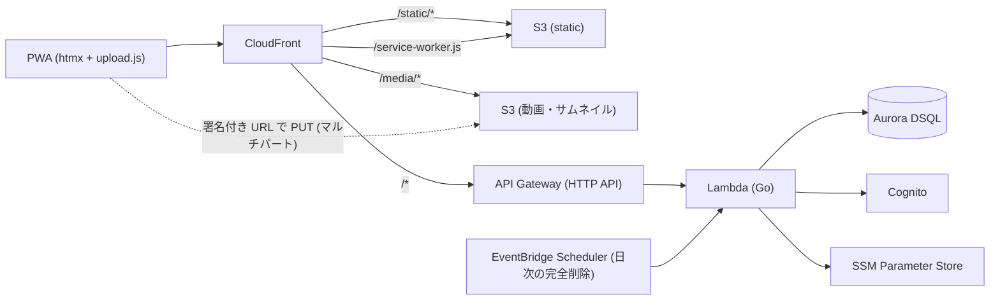
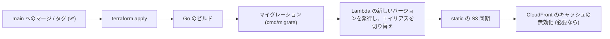

# family-video Architecture

[PRD](prd.md) の要件を、どう作るかの設計書。全体構成だけをここに書き、細かい設計は [specs/](#specs) に分ける。方式を選んだ理由は [ADR](adr/README.md) にある。

## Specs

| 文書 | 内容 |
|---|---|
| [upload.md](specs/upload.md) | アップロード・再開 |
| [playback.md](specs/playback.md) | 一覧・再生・ダウンロード・お気に入り |
| [data.md](specs/data.md) | 保存する情報・削除と完全削除・バックアップ・保存料の目安 |
| [security.md](specs/security.md) | 認証・配信・権限・乱用対策 |
| [observability.md](specs/observability.md) | ログ・アラーム・通知 |
| [operations.md](specs/operations.md) | Runbook・依存・テスト・性能・画面の方針 |

## Architecture

判断の理由: [ADR-0001](adr/0001-cloud-aws-serverless.md) / [ADR-0007](adr/0007-video-storage-delivery.md)

入り口は CloudFront の 1 つだけ。パスごとに S3 と API へ振り分けるので、ブラウザから見ると同一オリジンになり、CORS は要らない。動画のアップロードだけは、署名付き URL で S3 に直接送る。

### Routing

| パス | 振り分け先 | 備考 |
|---|---|---|
| `/static/*` | S3 | htmx・CSS・JS・manifest。OAC (CloudFront からだけ読める) |
| `/service-worker.js` | S3 | Service Worker。scope を `/` にするため、ルートのパスで配信する。`/static/*` と同じ S3 から返すビヘイビアを 1 つ足す |
| `/media/*` | S3 | 動画とサムネイル。OAC と署名付き URL |
| `/*` | API Gateway → Lambda | 画面 (html/template)・`/auth/*`・`/api/*` |

### Components

- Lambda は 1 つ。Go の zip を provided.al2023 で動かし、VPC には置かない。同じ Lambda を EventBridge Scheduler からも呼ぶ
- 画面は Go の `html/template` で作り、htmx で部分更新する。ビルド工程はなく、htmx は 2.0.11 に固定して `/static/` から配信する
- 状態は URL・サーバー・素の JS (アップロードだけ) に持たせる
- Go の外部依存は aws-lambda-go・aws-sdk-go-v2・pgx に限る
- DB は Aurora DSQL。使う SQL は基本的な CRUD に限り、アクセスは `internal/db` に集める
- Cognito が家族のアカウントと認証を担い、SSM Parameter Store が署名用の鍵とオリジン検証の値を持つ
- Lambda の実行時間は短い。動画のデータは Lambda を通らないので、メモリとタイムアウトは小さめにする (値は実装時に決める)

## Environments

判断の理由: [ADR-0008](adr/0008-iac-environments.md)

- 環境は `dev` と `prod` の 2 つだけ (staging は作らない)。同じ Terraform のコードから作り、違いは変数 (地域制限・ログレベルなど) だけにする
- `dev` と `prod` は同じ AWS アカウントに置き、リソース名・IAM ロール・GitHub Environment で分ける (#20)
- 状態ファイルは環境ごとに別のキーにし、`dev` の操作が `prod` に影響しないようにする
- 独自ドメインは使わない。URL は CloudFront の既定のものを使い、公開リポジトリには書かない (#19)
- アカウント ID やドメインなどの環境固有の値は、GitHub の Environment 変数から渡す。`*.tfstate` と `*.tfvars` はコミットしない
- Terraform 本体と AWS プロバイダーのバージョンは固定し、`.terraform.lock.hcl` をコミットする

## CI/CD

判断の理由: [ADR-0011](adr/0011-repository-ci.md)

GitHub Actions で、AWS への認証は OIDC で行う。ロールは、読み取り専用・`dev`・`prod` の 3 つに分け、長期のアクセスキーは発行しない。

| ワークフロー | きっかけ | ロール |
|---|---|---|
| `.github/workflows/ci.yml` (未作成) | PR | 読み取り専用 |
| `.github/workflows/deploy.yml` (未作成) | main へのマージ / タグ (`v*`) | `dev` / `prod` |
| `.github/workflows/task.yml` (未作成) | 手動実行 (workflow_dispatch) | `dev` / `prod` |
| `.github/workflows/claude.yml` (既存) | PR や Issue のコメント | AWS には接続しない |

### ci.yml

PR のたびに、次を実行する。

1. `go test` (単体テストと、ローカルの PostgreSQL を使った結合テスト)
2. `govulncheck`
3. `terraform plan` (読み取り専用のロール)

### deploy.yml

main へのマージで `dev` に、タグ (`v*`) で `prod` にデプロイする。`prod` は GitHub Environment の承認を通す。`prod` のロールは、タグからの実行だけに限る。

- キャッシュの無効化は、`service-worker.js` などの差し替えを反映するために、必要なら行う
- マイグレーションは、デプロイのジョブが OIDC のロールで、Lambda を更新する前に実行する。DSQL は VPC の外にあり IAM 認証で接続できるので、マイグレーション用の Lambda は持たない
- 招待と復旧は Cognito のコンソールか CLI で、メンバーの除外と動画の復元は `cmd/task` で行う ([Operations](specs/operations.md))。管理用の Lambda は持たない

### task.yml

手動で実行する作業 (`cmd/task`) 用。入力は、作業の名前・環境・ドライランかどうか。`prod` は GitHub Environment の承認を通す。詳細は [Operations](specs/operations.md) にある。

### Notes

- Lambda はバージョンとエイリアスで管理する。デプロイに失敗したら、エイリアスを前のバージョンに戻す
- マイグレーションは前のバージョンのコードでも動く形で進める ([Data](specs/data.md))
- DSQL の制限はローカルの PostgreSQL では検出されないので、マイグレーションの SQL は `dev` の DSQL で確認する
- ローカル開発は `go run` とローカルの PostgreSQL (Docker) で行う。ローカルだけで使う仮のログインは、ビルドタグ `localdev` で用意し、AWS 上のバイナリには含めない
