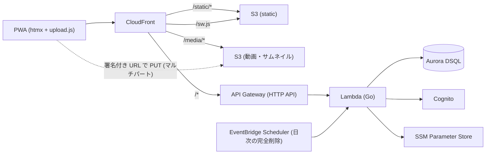
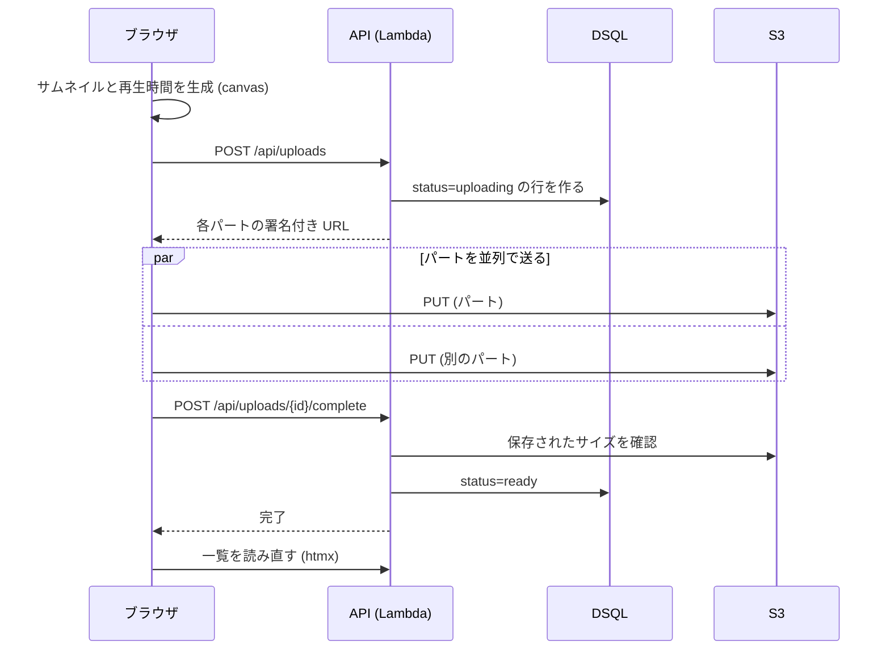
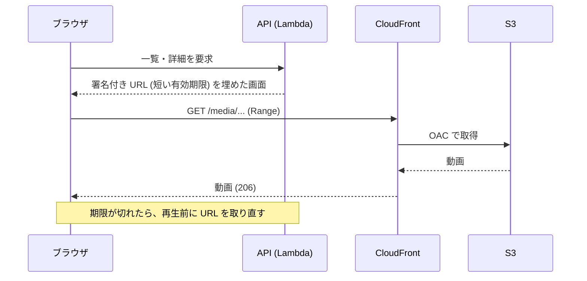
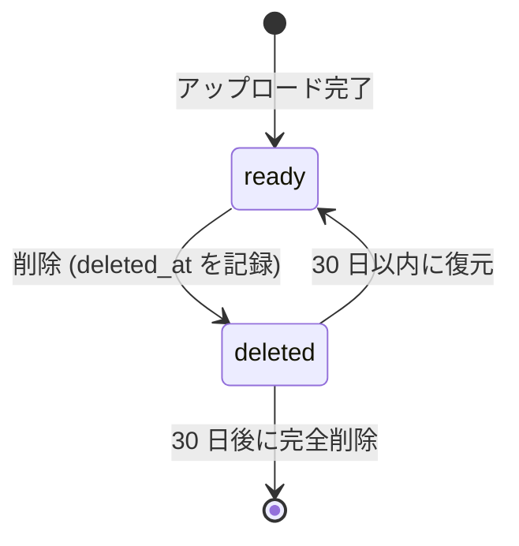
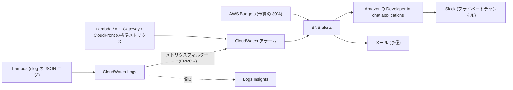

# family-video Architecture

[PRD](prd.md) の要件を、どう作るかの設計書。方式を選んだ理由は [ADR](adr/README.md) に書き、ここでは構成と細目だけを扱う。

## Architecture

判断の理由: [ADR-0001](adr/0001-cloud-aws-serverless.md) / [ADR-0007](adr/0007-video-storage-delivery.md)

入り口は CloudFront の 1 つだけ。パスごとに S3 と API へ振り分けるので、ブラウザから見ると同一オリジンになり、CORS は要らない。動画のアップロードだけは、署名付き URL で S3 に直接送る。



### パスの振り分け

| パス | 振り分け先 | 備考 |
|---|---|---|
| `/static/*` | S3 | htmx・CSS・JS・manifest。OAC (CloudFront からだけ読める) |
| `/sw.js` | S3 | Service Worker。scope を `/` にするため、ルートのパスで配信する。`/static/*` と同じ S3 から返すビヘイビアを 1 つ足す |
| `/media/*` | S3 | 動画とサムネイル。OAC と署名付き URL |
| `/*` | API Gateway → Lambda | 画面 (html/template)・`/auth/*`・`/api/*` |

### 構成要素の方針

- Lambda は 1 つ。Go の zip を provided.al2023 で動かし、VPC には置かない
- 画面は Go の `html/template` で作り、htmx で部分更新する。ビルド工程はなく、htmx は 2.0.11 に固定して `/static/` から配信する
- 状態は URL・サーバー・素の JS (アップロードだけ) に持たせる
- Go の外部依存は aws-lambda-go・aws-sdk-go-v2・pgx に限る
- DB は Aurora DSQL。使う SQL は基本的な CRUD に限り、アクセスは `internal/db` に集める
- Lambda の実行時間は短い。動画のデータは Lambda を通らないので、メモリとタイムアウトは小さめにする (値は実装時に決める)

## Flows

### アップロード

判断の理由: [ADR-0007](adr/0007-video-storage-delivery.md)



- 動画は圧縮・変換せず、元の形式のまま保存する
- サムネイルと再生時間は端末側で作る。サムネイルは canvas で作り直すので、位置情報などの付随情報を含まない
- アップロード用の署名付き URL は、サーバーが決めたキーにだけ、短い有効期限で発行する
- 複数の動画は同時に 2 本まで送る
- 完了時に確認するのは、申告されたサイズと実際のサイズの一致だけ。一致しなければ WARN で記録し、失敗として扱う
- 動画ごとの状態は 待機中・送信中・完了・失敗 の 4 つ。失敗した動画だけを再送できる
- 中断しても、送信済みのパートを S3 に残し、IndexedDB に保存した進捗から続きを送る。再開時は未送信のパートの署名付き URL を取り直す
- iOS でファイルを選び直すと前の選択が消えるので、選択が終わった時点で JS のリストにファイルをコピーしておく
- 完了しなかったマルチパートアップロードは、ライフサイクルルールで 7 日後に自動削除する
- 1 本あたり・利用者ごとの本数と容量に上限は設けない

### 再生



- 署名は CloudFront の鍵で行い、秘密鍵は SSM Parameter Store に置く
- シークは HTTP の Range リクエストで行う。再生の開始時に、再読み込みなどの操作を求めない
- Service Worker (`/sw.js`) がキャッシュするのは画面の部品だけで、動画はキャッシュしない
- 画面は、文字を大きめにし、操作を少なくする (スマホに慣れていない家族も使えるようにするため)

### ダウンロード

- 一覧で複数の動画を選び、選んだ動画を 1 本ずつ順に保存する。ZIP にはせず、サーバー側でまとめる処理は持たない
- 動画ごとに署名付き URL を取り、元のファイルをそのまま取得して端末に保存する。保存させるための応答ヘッダー (Content-Disposition) の扱いは、実装時に決める
- 変換しないので、位置情報を含めて保存したときの内容のまま渡る

### お気に入り

- お気に入りは家族ごとの記録で、ほかの家族の表示には影響しない
- お気に入りの一覧は、月・年に関係なく自分のお気に入りだけを、期間をまたいで表示する

### 削除と復元



- 削除は論理削除で、`deleted_at` を記録する。一覧とお気に入りの一覧には出さない
- 完全削除は、同じ Lambda を EventBridge Scheduler で日次に実行して行う。30 日を過ぎた行と S3 のオブジェクトを消す
- S3 のオブジェクトは、古いバージョンを含めて全バージョンを消す。バージョニングで保持が 30 日延びることはない
- 完全削除した行は、DSQL のバックアップに最大 7 日残る
- 誤操作で S3 のオブジェクトを消した場合は、バージョニングから戻す (Runbook)

## Data

判断の理由: [ADR-0005](adr/0005-database-dsql.md)

| 保存先 | 内容 |
|---|---|
| S3 | 動画の本体とサムネイル。バージョニングを有効にし、古いバージョンは 30 日で削除する |
| DSQL `videos` | 動画 ID・アップロードした家族の ID (Cognito の `sub`)・S3 のキー・サイズ・撮影日時・再生時間・`status`・`deleted_at` |
| DSQL `favorites` | 家族の ID と動画 ID の組 (主キー)・登録日時 |
| Cognito | 家族のアカウント・パスキー・パスワード・TOTP |

- 撮影日時は UTC で保存し、画面には日本時間で表示する。月・年の範囲は日本時間で切り、UTC に直して検索する
- 一覧は撮影日の古い順で、`(撮影日時, 動画 ID)` を基準にしたページングで少しずつ読み込む。月ごと・年ごとを切り替え、最初は今月 (年ごとなら今年) を表示する
- お気に入りの一覧は、撮影日の新しい順に並べ、月・年の一覧と同じ基準のページングで読み込む
- 家族をメンバーから外しても、`videos` の行と動画は残す (アップロードした家族の ID は参照するだけで、削除に連動しない)
- 役割は分けない。家族は全員が同じ権限を持つ
- マイグレーションは、前のバージョンのコードでも動く形で進める (列の追加を先に行い、不要になった列の削除はあとで行う)
- アルバム・コメントは、あとからテーブルを追加して対応する
- 一括取り出しは、開発者が S3 と DB から行う (Runbook)

## Security

判断の理由: [ADR-0006](adr/0006-auth-cognito.md) / [ADR-0007](adr/0007-video-storage-delivery.md)

### 認証

- アカウントは開発者が Cognito で招待して作る。自己サインアップは無効にする
- ログインはパスキーが主。予備としてパスワードと TOTP を使える
- ログイン状態は HttpOnly Cookie で保持する。トークンは JS から読めない
- `/auth/callback` では `state`・PKCE・`nonce` を必ず検証する
- JWT の検証と認可の判定は、Lambda (Go) で行う
- ログインなしで通すのは `/auth/login`・`/auth/callback`・`/static/*` だけ。それ以外はログイン画面へリダイレクトし、DB には触れない
- アカウントの復旧は、パスキーの再登録を可能にして行う。開発者自身が締め出されたときの手段も用意する (Runbook)

### 配信と通信

| 項目 | 内容 |
|---|---|
| S3 | パブリックアクセスをすべてブロックし、CloudFront の OAC からだけ読む |
| 動画・サムネイルの配信 | CloudFront の署名付き URL (短い有効期限) だけ |
| アップロード | サーバーが決めたキーへの署名付き URL (短い有効期限) だけ |
| Cookie | `Secure`・`HttpOnly`・`SameSite=Lax` |
| CSRF | 書き込み系のリクエストで、`HX-Request` ヘッダーと Origin を確認する |
| CSP など | 外部のスクリプトは読み込まない。厳しい CSP・HSTS・`X-Content-Type-Options` を付ける |
| htmx | `allowEval = false`。自分のオリジン (`/static/`) から配信する |
| 検索エンジン | `robots.txt` で全ページ Disallow。CloudFront のレスポンスヘッダーポリシーで `X-Robots-Tag: noindex` を付ける |

### 権限

- IAM は Lambda ごとに最小権限にする。DSQL への接続は IAM 認証で、対象のクラスターだけに絞る
- デプロイは GitHub OIDC で行い、長期のアクセスキーは発行しない
- AWS のルートユーザーには MFA を設定し、普段は使わない
- Slack から AWS を操作する機能は使わない。通知に使うロールとガードレールは CloudWatch の読み取りだけにする

## Abuse Protection

判断の理由: [ADR-0010](adr/0010-abuse-protection.md)

WAF は使わず、次の層で防ぐ。

```text
CloudFront の地域制限 (JP のみ)
  → API Gateway のスロットリング
    → Lambda の middleware (オリジン検証・回数制限)
      → Lambda の予約同時実行数
```

### スロットリング

| 対象 | レート (/秒) | バースト | 実装 |
|---|---|---|---|
| ステージ全体 | 20 | 40 | API Gateway の既定のスロットリング |
| `POST /api/uploads` | 2 | 5 | API Gateway のルートごとの設定 |
| `POST /api/client-log` | 1 | 3 | API Gateway のルートごとの設定。Lambda のメモリ上のトークンバケットでも制限し、1 回あたりのサイズに上限を付ける |
| Lambda の予約同時実行数 | 10 | - | 全体の上限 |

- 値は運用しながら調整する
- 上限を超えたら `429` と `Retry-After` を返し、画面に再試行を促す表示を出す
- Terraform では `throttling_burst_limit` と `throttling_rate_limit` を必ず明記する。消すと 0 になり、すべての通信が止まる
- ログインの総当たりは、Cognito の標準のロック機能で防ぐ。パスワードで 5 回失敗すると 1 秒ロックされ、失敗のたびに倍になり、最大約 15 分になる
- アップロードの本数と容量に上限は設けない。保存量の増加と費用は、AWS Budgets のアラートと S3 の保存量のメトリクスで把握する

### 地域制限とオリジン検証

- CloudFront の地域制限で、日本 (`JP`) だけを許可する (追加料金なし)
- CloudFront からオリジンへのリクエストに、秘密のカスタムヘッダー `X-Origin-Verify` を付ける。Go の middleware で最初に検証し、一致しなければ `403` を返す。API Gateway の URL に直接アクセスされても、地域制限を回避されない
- ヘッダーの値は SSM Parameter Store に置き、定期的に入れ替える (Runbook)
- 独自ドメインを使わないので ([Operations](#operations))、API Gateway の既定のエンドポイントは無効にできない。直接アクセスへの備えは `X-Origin-Verify` が担う
- 海外旅行のときは、Terraform で旅行先の国を一時的に許可リストへ加える (Runbook)
- iCloud プライベートリレーを使っている端末が日本と判定されるかを、リリース前に確認する

## Observability

判断の理由: [ADR-0009](adr/0009-observability.md)

CloudWatch の標準機能だけで構成し、無料枠に収める。外部のサービスと追加の SDK は使わない。



### ログ

- Go 標準の `log/slog` で JSON を出力する。Lambda のログ形式も JSON にする
- ログレベルは、Lambda が設定する環境変数 `AWS_LAMBDA_LOG_LEVEL` から読む
- 記録する項目: リクエスト ID・メンバー ID (Cognito の `sub`)・ルート・ステータス・処理時間・動画 ID
- 記録しない項目: トークン・Cookie・署名付き URL・メールアドレス・ファイル名
- ロググループの保持期間は 30 日 (Terraform で設定する)
- 削除などの操作は、実行したメンバーと対象を記録する。AWS の操作履歴は CloudTrail のイベント履歴 (標準で 90 日) で確認する

### エラーの扱い

| 状況 | レベル |
|---|---|
| 共通 middleware で `recover` した panic | ERROR (スタックトレースとリクエスト ID 付き) |
| 5xx を返す処理 | ERROR |
| 認証の失敗・サイズの不一致 | WARN |
| そのほかの 4xx | ERROR にしない |

- ブラウザ側のエラー (`window.onerror`・`unhandledrejection`・`htmx:responseError`) は `POST /api/client-log` に送る。`source=client` を付けて ERROR で記録する
- 調査には、保存した Logs Insights のクエリ `filter level = "ERROR" | pattern @message` を使う。似たエラーを自動でまとめる

### メトリクスとダッシュボード

- Lambda・API Gateway・CloudFront・S3・DSQL が自動で出すメトリクスを使う
- カスタムメトリクスは無料枠の 10 個以内にする
- ダッシュボードは 1 つにし、Terraform で定義する (無料枠は 3 つまで)

### アラームと通知

アラームは無料枠の 10 個以内にする。

| 対象 | 条件の目安 |
|---|---|
| アプリの ERROR ログ (メトリクスフィルター `{ $.level = "ERROR" }`) | 5 分間に 1 件以上 |
| Lambda のエラー (タイムアウト・メモリ不足を含む) | 5 分間に 1 件以上 |
| API Gateway の 5xx | 5 分間に 1 件以上 |
| Lambda のスロットリング | 1 件以上 |
| Lambda の実行時間 | タイムアウトの 8 割に近づいた |
| AWS Budgets | 月額予算の 80% |
| 認証の失敗・4xx の急増 | 5 分間に通常の数倍 (値は運用しながら調整) |

- アラームと AWS Budgets の通知は、SNS トピック `alerts` に送る
- Slack ワークスペースの連携は、最初の 1 回だけコンソールで行う。以降のチャンネル設定は Terraform で管理し、ワークスペース ID とチャンネル ID は GitHub の Environment 変数から渡す
- アラームの説明欄に、保存した Logs Insights クエリへのリンクを書く

## Operations

判断の理由: [ADR-0008](adr/0008-iac-environments.md) / [ADR-0005](adr/0005-database-dsql.md)

### 環境

- 環境は `dev` と `prod` の 2 つだけ (staging は作らない)。同じ Terraform のコードから作り、違いは変数 (地域制限・ログレベルなど) だけにする
- `dev` と `prod` は同じ AWS アカウントに置き、リソース名・IAM ロール・GitHub Environment で分ける (#20)
- 状態ファイルは環境ごとに別のキーにし、`dev` の操作が `prod` に影響しないようにする
- 独自ドメインは使わない。URL は CloudFront の既定のものを使い、公開リポジトリには書かない (#19)
- アカウント ID やドメインなどの環境固有の値は、GitHub の Environment 変数から渡す。`*.tfstate` と `*.tfvars` はコミットしない
- Terraform 本体と AWS プロバイダーのバージョンは固定し、`.terraform.lock.hcl` をコミットする

### デプロイとロールバック

| きっかけ | 内容 |
|---|---|
| PR | 読み取り専用のロールで `terraform plan`・`go test`・`govulncheck` を実行する |
| main へのマージ | `dev` に自動でデプロイする (`terraform apply` → Go のビルド → Lambda の更新 → static の同期) |
| タグ (`v*`) | `prod` にデプロイする。`prod` のロールはタグからの実行だけに限定する |

- Lambda はバージョンとエイリアスで管理する。デプロイに失敗したら、エイリアスを前のバージョンに戻す
- DSQL の制限はローカルの PostgreSQL では検出されないので、マイグレーションの SQL は `dev` の DSQL で確認する
- ローカル開発は `go run` とローカルの PostgreSQL (Docker) で行う。ローカルだけで使う仮のログインは、ビルドタグ `localdev` で用意し、AWS 上のバイナリには含めない

### バックアップ

| 対象 | 方法 |
|---|---|
| 動画 (S3) | バージョニングで、削除や上書きの前の状態を 30 日間保持する。別リージョンへの複製と控えは行わない |
| メタデータ (DSQL) | AWS Backup で毎日取り、7 日分を保持する。RPO は最大 24 時間 (#21) |

- DSQL クラスターの削除保護をオンにする
- 復元は、バックアップから新しいクラスターを作り、アプリの接続先を差し替える。AWS Backup で Aurora DSQL のオプトインが必要になる
- DSQL には組み込みの PITR がない

### 費用の管理

- 固定費をほぼ 0 円にするため、配信・DB・認証・Lambda は無料枠に収める
- 保存は S3 Intelligent-Tiering にし、古い動画は自動で安い階層に移す
- AWS Budgets で月額のアラートを設定する (予算の 80% で通知)

保存料の目安 (東京リージョン・Intelligent-Tiering。単価は 2026-11 時点で、採用前に AWS Pricing Calculator で再確認する):

| 保存量 | 最近見られている場合 | ほぼすべて古い場合 |
|---|---|---|
| 100 GB | 約 $2.5 | 約 $0.5 |
| 500 GB | 約 $12.5 | 約 $2.5 |
| 1 TB | 約 $25.6 | 約 $5.1 |

- 既存の動画の移行は、各自がアップロードして行う。一括取り込みの手順は作らず、期限も設けない

### 依存の管理

- Dependabot が gomod・terraform・github-actions を月 1 回確認する
- govulncheck を週 1 回実行する
- Go のバージョンは年 1 回上げる。脆弱性の修正版が出たら、その都度上げる

### テスト

- Go の単体テストと、ローカルの PostgreSQL を使った結合テストを、CI で実行する
- リリース前に、iPhone で手動確認する。項目はログイン・複数アップロード・再開・再生・ホーム画面からの起動 (PWA)
- 動作確認の対象は、iOS の Safari と、ホーム画面に追加した PWA。iPhone で撮った動画 (HEVC) は iPhone でそのまま再生できる

### 性能

- 一覧の表示は、Lambda が温まっている状態で 1 秒以内を目安にする

### Runbook

開発者が行う次の操作を、`docs/runbook/` にまとめる (未作成)。

- 家族の追加とメンバーからの除外
- アカウントの復旧 (パスキーの再登録・開発者自身の復旧)
- 障害対応
- 署名用の鍵と `X-Origin-Verify` の値の入れ替え
- 海外旅行のときの地域制限の変更
- 誤操作からの復元 (S3 のバージョニング・DSQL のバックアップ)
- 元の動画とメタデータの一括取り出し

## Repository

判断の理由: [ADR-0011](adr/0011-repository-ci.md)

GitHub の public リポジトリで、モノレポにする。インフラとコードの変更を 1 つの PR で済ませる。

```text
family-video/
├─ infra/                      # Terraform (未作成)
│  ├─ bootstrap/               # 状態保存用 S3 バケットと GitHub OIDC ロール (最初に 1 回だけ)
│  ├─ main.tf  variables.tf  outputs.tf  versions.tf  backend.tf
│  ├─ envs/{dev,prod}.backend.hcl  # 環境ごとの状態ファイルのキー (値は CI から渡す)
│  └─ modules/{storage,cdn,api,auth,db}/
├─ app/                        # Go (未作成)
│  ├─ cmd/api/main.go          # Lambda 用とローカル用の起動を切り替える
│  ├─ cmd/migrate/main.go
│  ├─ internal/{auth,video,db,sign,web}/
│  ├─ templates/               # html/template (go:embed でバイナリに含める)
│  └─ migrations/
├─ static/                     # S3 の /static/* に同期 (未作成)
│  ├─ htmx.min.js              # 2.0.11 を固定して同梱
│  ├─ upload.js  app.css
│  └─ manifest.webmanifest  sw.js   # sw.js は CloudFront の /sw.js から配信する
├─ docs/
│  ├─ prd.md
│  ├─ architecture.md
│  ├─ adr/
│  └─ runbook/                 # (未作成)
├─ .github/
│  ├─ dependabot.yml
│  └─ workflows/
│     ├─ claude.yml            # @claude への応答 (既存)
│     └─ ci.yml  deploy.yml    # (未作成)
├─ CLAUDE.md
├─ LICENSE                     # MIT
└─ README.md
```

### CI/CD

- GitHub Actions と OIDC を使う。`dev` と `prod` で GitHub Environment ごとに、OIDC のロールと変数を分ける
- PR のレビューは、`@claude` と書いて頼む。PR や Issue に `@claude` と書くと、`claude.yml` が応答する
- main への直接 push は禁止し、PR を必須にする。CI が通らないとマージできないようにする
- 必須の承認数は 0。Claude の指摘を確認してから、自分でマージする
- 更新は Dependabot の PR で確認してから取り込む
- リポジトリの設定で、Issue を作れる人を書き込み権限のある人だけに制限する
- 「GitHub Actions に PR の作成と承認を許可する」はオフにする
- PR の作成をコラボレーターのみに制限した状態で、Dependabot の PR が作られることを確認する (#9)
