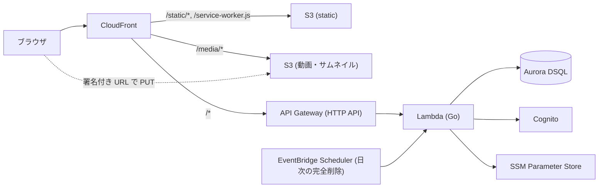
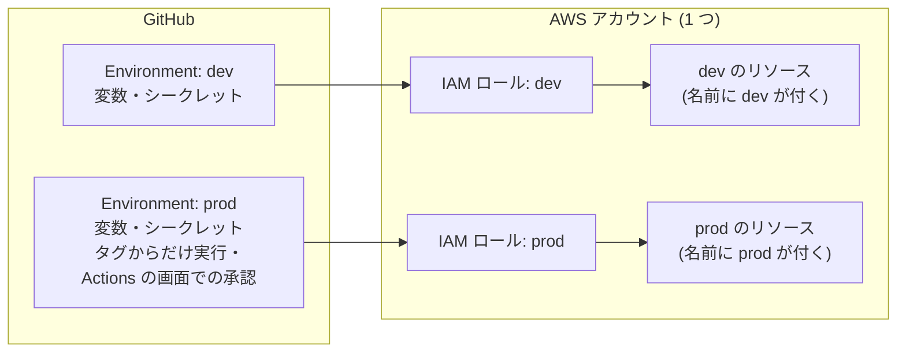
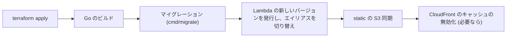

# family-video Architecture

[PRD](prd.md) の要件を、どう作るかの全体構成。細かい設計は下の文書、方式の理由は [ADR](adr/README.md) にある。

| 文書 | 内容 |
|---|---|
| [ui.md](specs/ui.md) | 画面の一覧・遷移・画面ごとの要素と状態 |
| [upload.md](specs/upload.md) | アップロード・再開 |
| [playback.md](specs/playback.md) | 一覧・再生・ダウンロード・お気に入り |
| [data.md](specs/data.md) | 保存する情報・削除・バックアップ・保存料 |
| [security.md](specs/security.md) | 認証・配信・権限・攻撃への対策 |
| [observability.md](specs/observability.md) | ログ・アラーム・通知 |
| [operations.md](specs/operations.md) | Runbook・手動の作業・テスト |

## Architecture

判断の理由: [ADR-0001](adr/0001-serverless.md) / [ADR-0006](adr/0006-lambda.md) / [ADR-0007](adr/0007-no-vpc.md) / [ADR-0016](adr/0016-entry.md) / [ADR-0017](adr/0017-api-http.md) / [ADR-0018](adr/0018-no-custom-domain.md) / [ADR-0019](adr/0019-video-transfer.md)

入り口は CloudFront の 1 つで、パスごとに S3 と API へ振り分ける (同一オリジンなので CORS は要らない)。アップロードだけは署名付き URL で S3 に直接送る。

## Tech Stack

| 区分 | 技術 | ADR |
|---|---|---|
| FE | `html/template` + htmx。MPA (HTML はサーバーが組み立てる) | [0004](adr/0004-mpa.md) / [0008](adr/0008-htmx.md) |
| BE | Go (Lambda 1 つ) | [0005](adr/0005-backend-go.md) / [0006](adr/0006-lambda.md) |
| API | API Gateway (HTTP API) | [0017](adr/0017-api-http.md) |
| DB | Aurora DSQL | [0012](adr/0012-database-dsql.md) / [0013](adr/0013-database-backup.md) |
| 認証 | Cognito (パスキー)・HttpOnly Cookie | [0009](adr/0009-auth-cognito.md) / [0010](adr/0010-login-passkey.md) / [0011](adr/0011-session-cookie.md) |
| 動画の保存・配信 | S3 + CloudFront | [0014](adr/0014-video-storage.md) / [0019](adr/0019-video-transfer.md) |
| 監視 | CloudWatch・Slack 通知 | [0022](adr/0022-observability.md) / [0023](adr/0023-notification.md) |
| IaC | Terraform | [0024](adr/0024-iac-terraform.md) |
| CI/CD | GitHub Actions | [0027](adr/0027-ci-cd.md) |

## Environments

判断の理由: [ADR-0025](adr/0025-environments.md)

環境は `dev` と `prod` の 2 つ。同じ AWS アカウントに置き、GitHub Environment・IAM ロール・リソース名で分ける。

- 環境ごとの値は GitHub Environment に置き、リポジトリには書かない。アカウント ID だけをシークレットにし、公開される Actions のログで伏せ字にする。ロールの ARN は命名規則から組み立てる
- 各ロールは自分の環境のリソースだけを変更できる。ロールを引き受けられるのは、同じ名前の Environment のジョブだけ (OIDC の `sub` で絞る)
- state は 1 つの S3 バケットをキー (`bootstrap/`・`dev/`・`prod/`) で分け、ロールごとに読み書きできるキーを絞る
- bootstrap (state のバケット・OIDC・ロール・予算) は `terraform/initial_setup/` にあり、手元の SSO の管理者だけが apply する ([Bootstrap](runbook/bootstrap.md))

## CI/CD

判断の理由: [ADR-0026](adr/0026-repository.md) / [ADR-0027](adr/0027-ci-cd.md)

GitHub Actions で、AWS へは OIDC で接続する。ロールは読み取り専用・`dev`・`prod` の 3 つで、長期のアクセスキーは発行しない。

| ワークフロー | きっかけ | 内容 |
|---|---|---|
| `ci.yml` (未作成) | PR | `go test`・`govulncheck`・`terraform plan` (読み取り専用。ログには変更の件数だけを出す) |
| `deploy.yml` (未作成) | main へのマージ / タグ (`v*`) | `dev` / `prod` へデプロイ (下の図) |
| `task.yml` (未作成) | 手動実行 | `cmd/task` ([Operations](specs/operations.md)) |
| `e2e.yml` (未作成) | 手動実行 | `dev` への E2E ([Operations](specs/operations.md)) |

- `prod` の Environment は、タグ (`v*`) からの実行だけを受け付け、Actions の画面で承認するまで止まる。`task.yml` も、実行するときにリリースのタグを選ぶ
- キャッシュの無効化は、`service-worker.js` などの差し替えを反映するため、必要なら行う。ロールバックは、エイリアスを前のバージョンに戻す
- マイグレーションは、デプロイのジョブが Lambda の更新前に実行する。前のバージョンでも動く形で進める ([Data](specs/data.md))。DSQL は IAM 認証で接続できるので、マイグレーション用の Lambda は持たない
- 招待と復旧は Cognito のコンソールか CLI で、メンバーの除外は `cmd/task` で行う。管理用の Lambda は持たない
