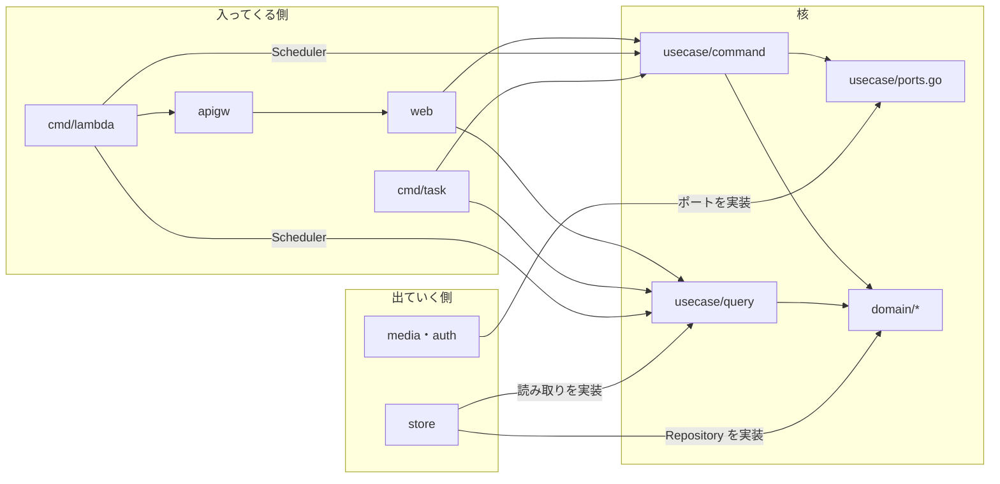

# Backend

[設計書](../architecture.md) の詳細。Go のコードの構成。

判断の理由: [ADR-0029](../adr/0029-backend-onion.md) / [ADR-0005](../adr/0005-backend-go.md) / [ADR-0006](../adr/0006-lambda.md) / [ADR-0012](../adr/0012-database-dsql.md)

オニオンアーキテクチャ (DDD) で作る。核を `domain` と `usecase` の 2 層に分け、その周りにアダプターを置く。依存はすべて中心へ向かう。業務の言葉と集約は [Domain](domain.md) にある。外部依存は aws-lambda-go・aws-sdk-go-v2・pgx だけ。

## Layout

```
app/                    go.mod (module github.com/Inouey1008/family-video/app)
├── cmd/
│   ├── lambda/         Lambda の入口。イベントを見て HTTP と Scheduler に振り分ける
│   ├── task/           手動作業のサブコマンド (ADR-0028)
│   └── migrate/        マイグレーション (migrations/ を embed して流す)
├── internal/
│   ├── domain/
│   │   ├── video/      集約 Video・値オブジェクト・イベント・Repository の interface
│   │   │   └── videotest/   メモリ上の Repository と契約テスト
│   │   ├── favorite/   集約 Favorite・Repository (favoritetest/ も同じ形)
│   │   └── member/     集約 Member・Repository (membertest/ も同じ形)
│   ├── usecase/
│   │   ├── command/    状態を変える操作。集約を読み、メソッドで変え、保存する
│   │   ├── query/      画面用の読み取りと、その読み取りのポート
│   │   ├── ports.go    Media・Auth のポート
│   │   └── usecasetest/     Media・Auth の偽物
│   └── adapter/
│       ├── apigw/      入ってくる側: HTTP API (v2) のイベント ⇄ net/http
│       ├── web/        入ってくる側: ルーティング・middleware・ハンドラー・テンプレート (embed)
│       ├── store/      出ていく側: 各 Repository と query の読み取りを実装。SQL はここだけ
│       ├── media/      出ていく側: S3 のマルチパート・削除、CloudFront の署名付き URL
│       ├── auth/       出ていく側: Cognito の腐敗防止層 (認可コードフロー・JWT の検証・Cookie)
│       └── config/     環境変数と SSM
├── migrations/         番号付きの SQL
└── static/             S3 (static) に同期するファイル
e2e/                    Playwright Test (TypeScript, yarn)。配らない開発用のツール ([Testing](testing.md))
```

- 偽物は、インターフェースを持つパッケージの下の `〜test` に置く (Grafana と Go の `httptest` に倣う)
- 契約テストは同じパッケージに公開の関数で置き、メモリ上の偽物と store の両方から呼ぶ。偽物が本物と同じ振る舞いをすることを保つため ([Testing](testing.md))

## Dependencies



- 入口 (`cmd/*`) は設定を読み、アダプターを組み立てて usecase に渡すだけ
- web は業務の規則を持たない。command・query を呼んでテンプレートを描画する
- ポートは必要な分だけ作る (Google Go Style Guide)。Media (S3・CloudFront) と Auth (Cognito) のポートは `usecase/ports.go` に置く
- リポジトリの interface は domain の集約のパッケージに置く。読み取りは集約を通さず `usecase/query` が直接読む。理由は [Domain](domain.md) にある

## Entry Points

| 入口 | 起動 | 内容 |
|---|---|---|
| HTTP | API Gateway (HTTP API) | 画面と API。`adapter/web` が処理する |
| Scheduler | EventBridge Scheduler | 日次の完全削除 (purge) |
| `cmd/task` | 手元・`task.yml` | 手動作業 ([Operations](operations.md)) |
| `cmd/migrate` | デプロイのジョブ | Lambda の更新前にマイグレーションを流す |

`cmd/lambda` は生の JSON を受け取り、中身を見て振り分ける。

- `job` があれば Scheduler の呼び出しとして扱う
- `requestContext` があれば HTTP API の呼び出しとして扱う
- どちらもなければエラーにする

EventBridge Scheduler のスケジュールの入力 (payload) に `{"job":"purge"}` を設定する。payload を指定しないと、空のイベントが届くため。

Scheduler は Lambda を非同期で呼び出し、失敗すると再試行される。purge は何度流しても壊れない形にする。

手元では、同じバイナリを net/http のサーバーとして起動できる。Lambda の環境変数がないときに、`cmd/lambda` がこの動きになる。

参考: [Lambda と EventBridge Scheduler](https://docs.aws.amazon.com/lambda/latest/dg/with-eventbridge-scheduler.html)

## Lambda Adapter

`adapter/apigw` は、API Gateway (HTTP API) のイベントと net/http を変換する。aws-lambda-go の `events.APIGatewayV2HTTP*` と標準ライブラリだけで書く。`lambdaurl` は関数 URL のレスポンスストリーミング専用で、HTTP API には使えない。

payload 2.0 の注意点は次のとおり。

- クエリは `rawQueryString` を使う
- `cookies` 配列を Cookie ヘッダーに戻す
- Set-Cookie は、レスポンスの `cookies` に 1 件ずつ入れる
- 本文は base64 の入出力がある
- `rawPath` のエンコードの扱いは、dev で確かめる

参考: [HTTP API の Lambda 統合 (payload 2.0)](https://docs.aws.amazon.com/apigateway/latest/developerguide/http-api-develop-integrations-lambda.html)

## Database

SQL は `adapter/store` に集める。

- DSQL へは IAM 認証のトークンで接続する ([ADR-0012](../adr/0012-database-dsql.md))。手元と CI はローカルの PostgreSQL に接続する ([Testing](testing.md))
- 1 command で 1 集約を 1 トランザクションで保存する。理由は [Domain](domain.md) にある
- トランザクションは pgx の `TxOptions` で REPEATABLE READ を明示する。DSQL はこの分離レベルに固定されている
- 競合は SQLSTATE 40001 だけを見て、COMMIT を含むトランザクション全体を再試行する
  - DSQL は COMMIT のときに 40001 を返す
  - PostgreSQL は、同じ行への 2 つ目の UPDATE のときに 40001 を返す

参考: [DSQL の並行制御](https://docs.aws.amazon.com/aurora-dsql/latest/userguide/working-with-concurrency-control.html)

## Migrations

DSQL の書き方を正とする。`CREATE INDEX ASYNC` は DSQL で必須で、PostgreSQL では構文エラーになる。

- `cmd/migrate` は、接続先が PostgreSQL のときだけ `INDEX ASYNC` を `INDEX` に置き換える
- DSQL では `sys.wait_for_job` で、インデックスの作成の完了を待つ
- 1 ファイル 1 文にする
- 文ごとに別のトランザクションで流し、版の記録も別のトランザクションにする
- 途中で止まっても流し直せるよう、`IF NOT EXISTS` を付ける
- DSQL で通らない書き方 (ASYNC のない CREATE INDEX・CREATE TYPE・1 ファイルに複数の文など) は、`migrations/` を走査する Go の単体テストで検出する ([Testing](testing.md))

参考: [DSQL の CREATE INDEX](https://docs.aws.amazon.com/aurora-dsql/latest/userguide/create-index-syntax-support.html) / [DSQL の PostgreSQL との差](https://docs.aws.amazon.com/aurora-dsql/latest/userguide/working-with-postgresql-compatibility-unsupported-features.html)

## Templates and Static

- テンプレート (`html/template`) は `adapter/web` に embed し、バイナリに含める
- `app/static/` は、デプロイの最後に S3 (static) へ同期する。CloudFront が `/static/*` と `/service-worker.js` を S3 から返す ([設計書](../architecture.md))
