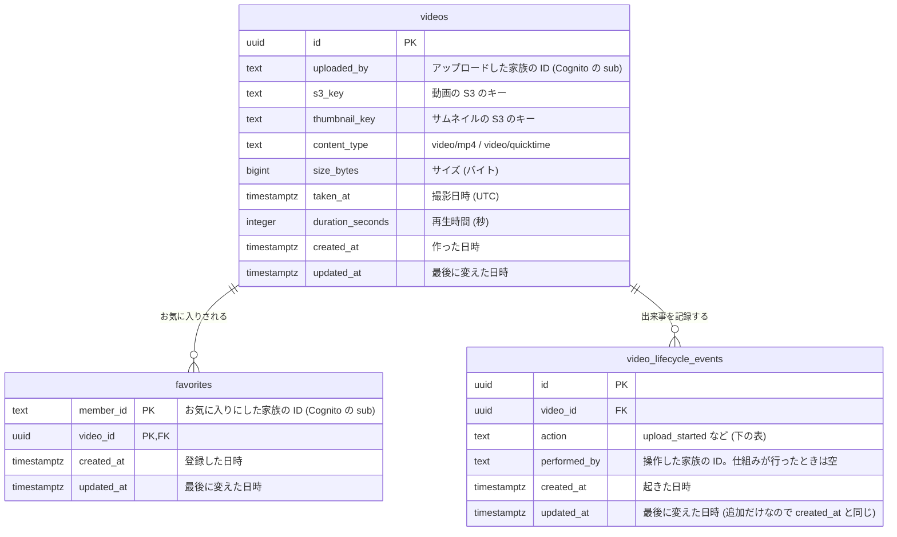
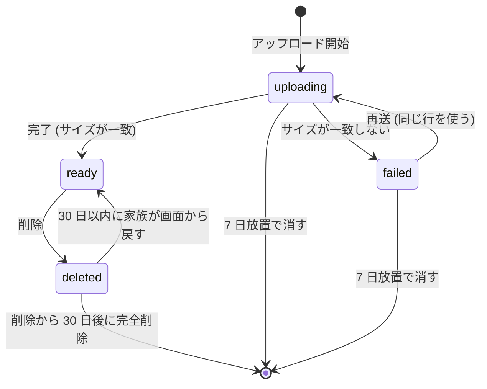

# Data

[設計書](../architecture.md) の詳細。保存する情報・削除・バックアップ。

判断の理由: [ADR-0012](../adr/0012-database-dsql.md) / [ADR-0014](../adr/0014-video-storage.md) / [ADR-0015](../adr/0015-video-deletion.md) / [ADR-0013](../adr/0013-database-backup.md)

## Stored Data

※ 型は仮。確定はマイグレーションを作るときに行う
※ DSQL には外部キーがないので、関係は論理上のもの。整合はアプリで保つ
※ 家族の情報は Cognito が持つので、家族のテーブルは作らない
※ `video_lifecycle_events` は追加だけで、書き換えも削除もしない
※ 「誰がしたか」は `〜_by`、「誰のものか」は `member_id` と名付ける。どちらにも家族の ID (Cognito の `sub`) を入れる
※ すべてのテーブルに `created_at` と `updated_at` を持つ。DSQL はトリガーが使えないので、アプリが書き込むたびに入れる

- S3: 動画とサムネイル
- 撮影日時は UTC で保存し、日本時間で表示する
- 家族を除外しても、`videos` の行と動画は残す

## Lifecycle

状態は列に持たず、その動画の最後のイベントの `action` で決まる。

| 遷移 | きっかけ | 操作する人 | 足す action |
|---|---|---|---|
| 開始 → `uploading` | `POST /api/uploads` | アップロードした家族 | `upload_started` |
| `uploading` → `ready` | 完了し、サイズが一致した | アップロードした家族 | `upload_completed` |
| `uploading` → `failed` | 完了したが、サイズが一致しない | 仕組み | `upload_failed` |
| `failed` → `uploading` | [再送] を押した | アップロードした家族 | `upload_started` |
| `ready` → `deleted` | [削除] を押した | 家族 (誰でも) | `deleted` |
| `deleted` → `ready` | [元に戻す] を押した | 家族 (誰でも) | `restored` |
| `deleted` → 消す | 削除から 30 日たった | 仕組み | `purged` |
| `uploading` / `failed` → 消す | 7 日放置された | 仕組み | `purged` |

| 最後の action | 状態 |
|---|---|
| `upload_started` | `uploading` |
| `upload_completed`・`restored` | `ready` |
| `upload_failed` | `failed` |
| `deleted` | `deleted` |

- 状態を変えるときは、`video_lifecycle_events` に 1 行足す。同じトランザクションで、今の状態から移れるかを確かめ、`videos` の `updated_at` も更新する
- `videos` の `updated_at` を更新するのは、同時に 2 つの操作 (削除と復元など) が来たときに、DSQL の楽観的な同時実行制御で片方を失敗させるため。イベントの追加だけでは、ぶつかったことに気づけない
- イベントの順番は `created_at` で決め、同じ時刻なら `id` で決める (`id` は時刻順に並ぶ UUIDv7)
- 最後のイベントを速く引けるよう、`video_lifecycle_events (video_id, created_at)` に索引を張る
- 削除した日時と削除した家族は、最後の `deleted` のイベントから取る
- 7 日放置の判定は、最後のイベントが `upload_started` か `upload_failed` のまま、7 日たったかで行う
- 通常の一覧は `ready` だけを出す。`uploading` と `failed` はアップロードの画面に、`deleted` は「削除した動画」の画面に出す ([UI](ui.md))
- 家族は誰が削除した動画でも、「削除した動画」の画面から戻せる
- 消す処理は、EventBridge Scheduler が同じ Lambda を日次に呼んで行う。`videos` の行と、S3 の全バージョン (古いバージョンを含む) を消す。`video_lifecycle_events` は `purged` を足して残す
- 7 日放置の期間は、S3 の送りかけのパートを消すライフサイクルルール (7 日) と合わせている ([Upload](upload.md))
- 消した行は、DSQL のバックアップに最大 7 日残る

## Backup

- S3: バージョニングで、削除や上書きの前の状態を 30 日間保持する。別リージョンへの複製はしない
- DSQL: AWS Backup で毎日取り、7 日分を保持する (RPO は最大 24 時間)。クラスターの削除保護をオンにする
- DSQL の復元は、新しいクラスターを作り、アプリの接続先を差し替える

## Storage Cost

S3 Intelligent-Tiering (東京。2026-11 時点の単価で、採用前に AWS Pricing Calculator で再確認する)。

| 保存量 | 最近見られている | ほぼすべて古い |
|---|---|---|
| 100 GB | 約 $2.5 | 約 $0.5 |
| 500 GB | 約 $12.5 | 約 $2.5 |
| 1 TB | 約 $25.6 | 約 $5.1 |
