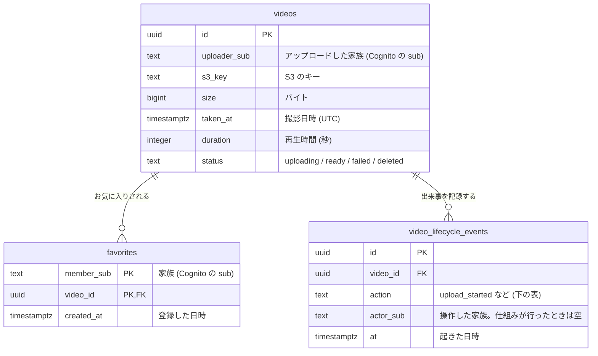
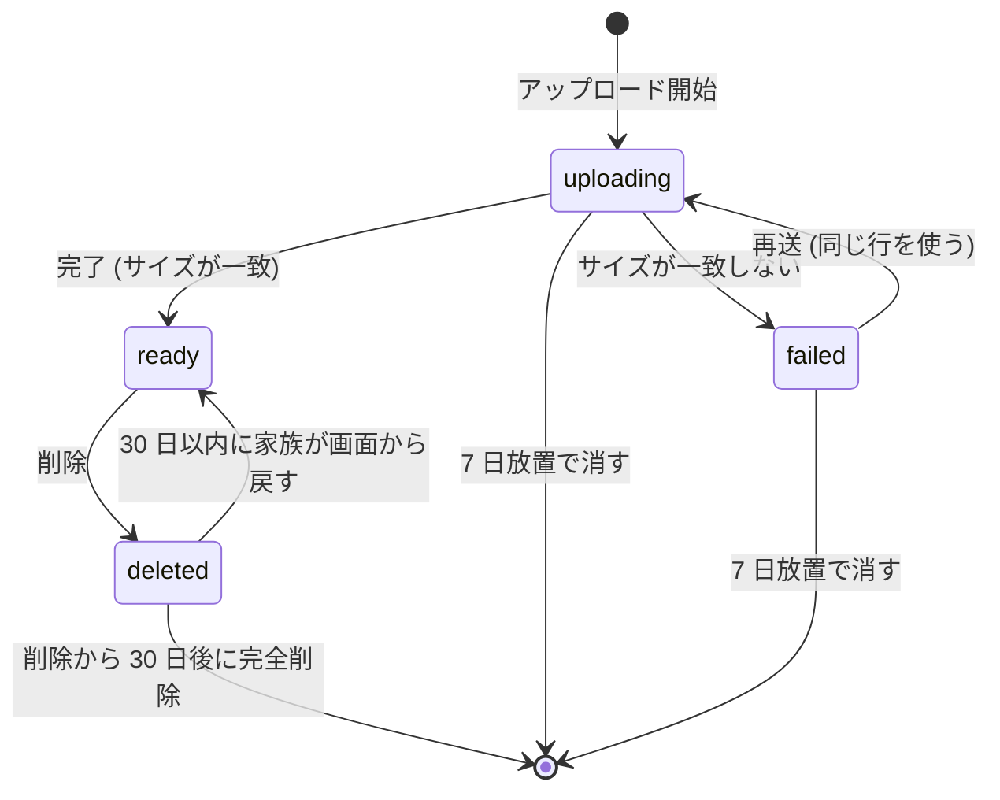

# Data

[設計書](../architecture.md) の詳細。保存する情報・削除・バックアップ。

判断の理由: [ADR-0012](../adr/0012-database-dsql.md) / [ADR-0014](../adr/0014-video-storage.md) / [ADR-0015](../adr/0015-video-deletion.md) / [ADR-0013](../adr/0013-database-backup.md)

## Stored Data

※ 型は仮。確定はマイグレーションを作るときに行う
※ DSQL には外部キーがないので、関係は論理上のもの。整合はアプリで保つ
※ 家族の情報は Cognito が持つので、家族のテーブルは作らない
※ `video_lifecycle_events` は追加だけで、書き換えも削除もしない

- S3: 動画とサムネイル
- 撮影日時は UTC で保存し、日本時間で表示する
- 家族を除外しても、`videos` の行と動画は残す

## Lifecycle

| 遷移 | きっかけ | 操作する人 | action |
|---|---|---|---|
| 開始 → `uploading` | `POST /api/uploads` | アップロードした家族 | `upload_started` |
| `uploading` → `ready` | 完了し、サイズが一致した | アップロードした家族 | `upload_completed` |
| `uploading` → `failed` | 完了したが、サイズが一致しない | 仕組み | `upload_failed` |
| `failed` → `uploading` | [再送] を押した | アップロードした家族 | `upload_started` |
| `ready` → `deleted` | [削除] を押した | 家族 (誰でも) | `deleted` |
| `deleted` → `ready` | [元に戻す] を押した | 家族 (誰でも) | `restored` |
| `deleted` → 消す | 削除から 30 日たった | 仕組み | `purged` |
| `uploading` / `failed` → 消す | 7 日放置された | 仕組み | `purged` |

- 状態を変えるときは、`videos` の `status` の更新と `video_lifecycle_events` への追加を、同じトランザクションで行う
- 削除した日時は、`video_lifecycle_events` の最後の `deleted` から取る。`videos` には持たない
- 通常の一覧は `ready` だけを出す。`uploading` と `failed` はアップロードの画面に、`deleted` は「削除した動画」の画面に出す ([UI](ui.md))
- 家族は誰が削除した動画でも、「削除した動画」の画面から戻せる
- 消す処理は、EventBridge Scheduler が同じ Lambda を日次に呼んで行う。`videos` の行と、S3 の全バージョン (古いバージョンを含む) を消す。`video_lifecycle_events` は `purged` を足して残す
- 7 日放置の期間は、S3 の送りかけのパートを消すライフサイクルルール (7 日) と合わせている ([Upload](upload.md))
- 消した行は、DSQL のバックアップに最大 7 日残る

## Backup

- S3: バージョニングで、削除や上書きの前の状態を 30 日間保持する。別リージョンへの複製はしない
- DSQL: AWS Backup で毎日取り、7 日分を保持する (RPO は最大 24 時間)。クラスターの削除保護をオンにする
- DSQL の復元は、新しいクラスターを作り、アプリの接続先を差し替える

## Storage Cost

S3 Intelligent-Tiering (東京。2026-11 時点の単価で、採用前に AWS Pricing Calculator で再確認する)。

| 保存量 | 最近見られている | ほぼすべて古い |
|---|---|---|
| 100 GB | 約 $2.5 | 約 $0.5 |
| 500 GB | 約 $12.5 | 約 $2.5 |
| 1 TB | 約 $25.6 | 約 $5.1 |
