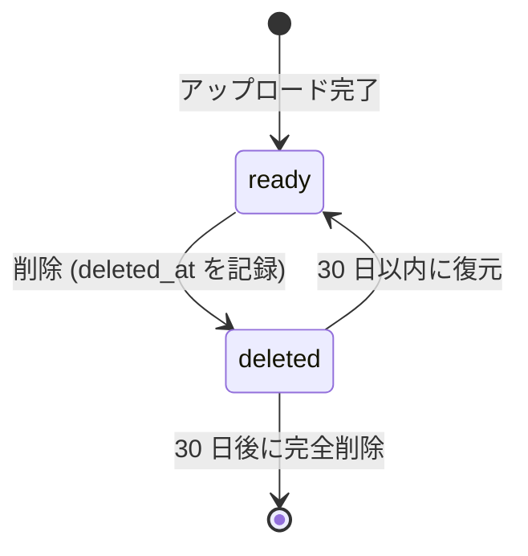

# Data

[設計書](../architecture.md) の詳細。保存する情報、削除、バックアップ、費用の目安。

判断の理由: [ADR-0005](../adr/0005-database-dsql.md)

## Stored Data

| 保存先 | 内容 |
|---|---|
| S3 | 動画の本体とサムネイル。バージョニングを有効にし、古いバージョンは 30 日で削除する |
| DSQL `videos` | 動画 ID・アップロードした家族の ID (Cognito の `sub`)・S3 のキー・サイズ・撮影日時・再生時間・`status`・`deleted_at` |
| DSQL `favorites` | 家族の ID と動画 ID の組 (主キー)・登録日時 |
| Cognito | 家族のアカウント・パスキー・パスワード・TOTP |

- 撮影日時は UTC で保存し、画面には日本時間で表示する
- 家族をメンバーから外しても、`videos` の行と動画は残す (アップロードした家族の ID は参照するだけで、削除に連動しない)
- 役割は分けない。家族は全員が同じ権限を持つ
- アルバム・コメントは、あとからテーブルを追加して対応する
- マイグレーションは、前のバージョンのコードでも動く形で進める (列の追加を先に行い、不要になった列の削除はあとで行う)
- 一括取り出しは、開発者が S3 と DB から行う (Runbook)

## Delete and Restore

- 削除は論理削除で、`deleted_at` を記録する。一覧とお気に入りの一覧には出さない
- 完全削除は、同じ Lambda を EventBridge Scheduler で日次に実行して行う。30 日を過ぎた行と S3 のオブジェクトを消す
- S3 のオブジェクトは、古いバージョンを含めて全バージョンを消す。バージョニングで保持が 30 日延びることはない
- 完全削除した行は、DSQL のバックアップに最大 7 日残る
- 誤操作で S3 のオブジェクトを消した場合は、バージョニングから戻す (Runbook)

## Backup

| 対象 | 方法 |
|---|---|
| 動画 (S3) | バージョニングで、削除や上書きの前の状態を 30 日間保持する。別リージョンへの複製と控えは行わない |
| メタデータ (DSQL) | AWS Backup で毎日取り、7 日分を保持する。RPO は最大 24 時間 (#21) |

- DSQL クラスターの削除保護をオンにする
- 復元は、バックアップから新しいクラスターを作り、アプリの接続先を差し替える。AWS Backup で Aurora DSQL のオプトインが必要になる
- DSQL には組み込みの PITR がない

## Storage Cost

- 保存は S3 Intelligent-Tiering にし、古い動画は自動で安い階層に移す

保存料の目安 (東京リージョン・Intelligent-Tiering。単価は 2026-11 時点で、採用前に AWS Pricing Calculator で再確認する):

| 保存量 | 最近見られている場合 | ほぼすべて古い場合 |
|---|---|---|
| 100 GB | 約 $2.5 | 約 $0.5 |
| 500 GB | 約 $12.5 | 約 $2.5 |
| 1 TB | 約 $25.6 | 約 $5.1 |
