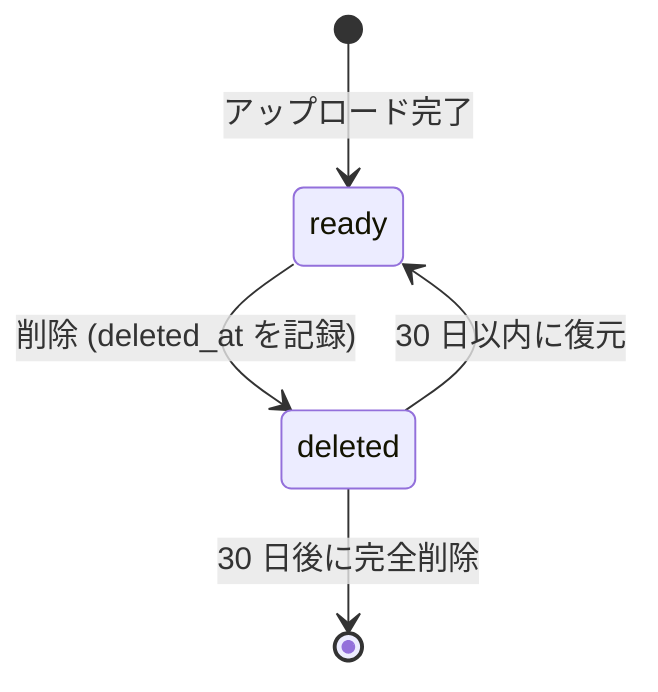

# Data

[設計書](../architecture.md) の詳細。保存する情報・削除・バックアップ。

判断の理由: [ADR-0012](../adr/0012-database-dsql.md) / [ADR-0014](../adr/0014-video-storage.md) / [ADR-0015](../adr/0015-video-deletion.md) / [ADR-0013](../adr/0013-database-backup.md)

## Stored Data

- S3: 動画とサムネイル
- DSQL `videos`: 動画 ID・アップロードした家族の ID (Cognito の `sub`)・S3 のキー・サイズ・撮影日時・再生時間・`status`・`deleted_at`
- DSQL `favorites`: 家族の ID と動画 ID の組・登録日時
- 撮影日時は UTC で保存し、日本時間で表示する
- 家族を除外しても、`videos` の行と動画は残す

## Delete and Restore

- 削除した動画は一覧に出さない。復元は `cmd/task` で行う ([Operations](operations.md))
- 完全削除は、EventBridge Scheduler が同じ Lambda を日次に呼んで行う。30 日を過ぎた行と、S3 の全バージョン (古いバージョンを含む) を消す
- 完全削除した行は、DSQL のバックアップに最大 7 日残る

## Backup

- S3: バージョニングで、削除や上書きの前の状態を 30 日間保持する。別リージョンへの複製はしない
- DSQL: AWS Backup で毎日取り、7 日分を保持する (RPO は最大 24 時間)。クラスターの削除保護をオンにする
- DSQL の復元は、新しいクラスターを作り、アプリの接続先を差し替える

## Storage Cost

S3 Intelligent-Tiering (東京。2026-11 時点の単価で、採用前に AWS Pricing Calculator で再確認する)。

| 保存量 | 最近見られている | ほぼすべて古い |
|---|---|---|
| 100 GB | 約 $2.5 | 約 $0.5 |
| 500 GB | 約 $12.5 | 約 $2.5 |
| 1 TB | 約 $25.6 | 約 $5.1 |
