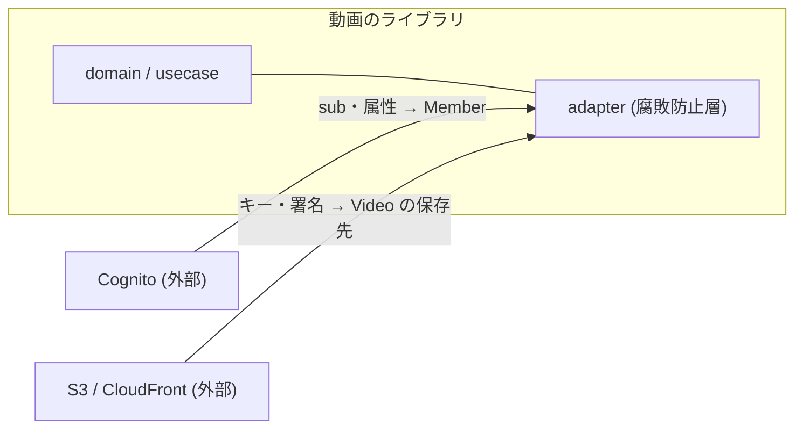

# Domain

[設計書](../architecture.md) の詳細。業務の言葉とモデル。

判断の理由: [ADR-0029](../adr/0029-backend-onion.md) / [ADR-0012](../adr/0012-database-dsql.md)

## Ubiquitous Language

画面・docs・コードで同じ言葉を使う。

| 言葉 | コードの名前 | 意味 |
|---|---|---|
| 動画 | `Video` | 家族がアップロードした 1 本の動画。状態を持つ |
| 家族 (メンバー) | `Member` | ログインして使う人。ID は Cognito の `sub` |
| お気に入り | `Favorite` | 家族が動画に付ける印。家族と動画の組で 1 つ |
| 状態 | `State` | 動画の今の状況。`uploading`・`ready`・`failed`・`deleted` |
| 出来事 | `Action` | 動画に起きたこと。`upload_started`・`upload_completed`・`upload_failed`・`deleted`・`restored`・`purged` |
| アップロード | `upload_started` から `upload_completed` | 家族が動画を送ること。サイズが一致すると完了する |
| 削除 | `Delete` | 動画を通常の一覧から外すこと。30 日は戻せる |
| 元に戻す | `Restore` | 削除した動画を通常の一覧へ戻すこと |
| 完全削除 | `Purge` | `videos` の行と S3 の全バージョンを消すこと。`video_lifecycle_events` は `purged` を足して残す。仕組みが日次で行う |
| 放置 | - | `uploading` か `failed` のまま 7 日たった状態。完全削除の対象 |
| 撮影日時 | `TakenAt` | 動画を撮った日時。UTC で持ち、日本時間で表示する |

状態の遷移と、出来事を足す条件は [Data](data.md) の Lifecycle を参照。

## Subdomains

| 種類 | 範囲 | 方針 |
|---|---|---|
| コア | 動画のライブラリ (保存・ライフサイクル・閲覧・お気に入り) | 作り込む。規則を domain に集める |
| 汎用 | 認証 (Cognito)・保存と配信 (S3・CloudFront)・通知 | 作り込まない。マネージドサービスを使い、adapter で包む |

## Context Map

境界づけられたコンテキストは 1 つ (動画のライブラリ)。Cognito と S3 は外部のコンテキストで、adapter が腐敗防止層として翻訳し、外の言葉を domain に入れない。

## Aggregates

| 集約 | 中身 | 不変条件 |
|---|---|---|
| Video | 動画の情報とライフサイクル | 遷移は [Data](data.md) の表のとおり。アップロードの開始・完了はアップロードした家族だけ。戻せるのは削除から 30 日以内。完全削除の対象は削除から 30 日・7 日放置 |
| Favorite | メンバー × 動画 | 同じ組は 1 つ。登録できるのは `ready` の動画だけ。削除しても Favorite は消さない |
| Member | 表示名 | 初回ログイン (`/auth/callback`) で作る |

- Favorite を Video から分ける。お気に入りで Video の `updated_at` が変わると、削除・復元と楽観的並行制御でぶつかるため
- 1 つの command は 1 つの集約を 1 トランザクションで保存する。楽観的並行制御の単位は集約 (`updated_at`)
- 集約をまたぐ規則 (お気に入りは `ready` の動画だけ) は、command で確かめる
- 集約のフィールドは非公開にする。作るときは `New` (検証する)、DB から戻すときは専用の関数 (検証済みとして組み立てる) を使う
- 置き場所は `internal/domain/video`・`internal/domain/favorite`・`internal/domain/member`

## Value Objects

| 名前 | 内容 |
|---|---|
| `VideoID` | UUIDv7 |
| `MemberID` | Cognito の `sub` |
| `State` | `uploading`・`ready`・`failed`・`deleted` |
| `Action` | 出来事の種類 |
| `TakenAt` | 撮影日時。UTC で持ち、日本時間で出す |
| `Size` | 動画のサイズ。10 GB まで |
| `ContentType` | `video/mp4`・`video/quicktime` |

## Domain Events

- 遷移のメソッド (`Delete(by, now)` など) がライフサイクルのイベントを返す
- リポジトリが Video と同じトランザクションで `video_lifecycle_events` に足す
- イベントを配る仕組み (バス) は持たない

## Repositories

- 集約ごとに 1 つ持つ
- interface は domain の集約のパッケージ (`internal/domain/video` など) に置く。Go では interface を使う側に置くのが通例だが、リポジトリは集約の保存先を表す domain の概念で、`usecase` が変わっても形が変わらないため、例外とする
- 実装は `internal/adapter/store`。メモリ上の偽物は各パッケージの `〜test` に置き、同じ契約テストを流す ([Testing](testing.md))

## Reads

- 一覧・詳細・削除した動画・アップロード中は、集約を通さず `internal/usecase/query` が画面の形で直接読む
- CQRS (コマンドとクエリの責務分離) のうち、読み書きの分離だけを取り入れる。DB は 1 つのまま
