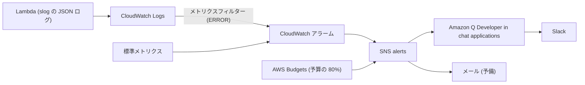

# Observability

[設計書](../architecture.md) の詳細。ログ・アラーム・通知。

判断の理由: [ADR-0016](../adr/0016-observability.md)

CloudWatch の標準機能だけで構成し、無料枠に収める。外部のサービスと追加の SDK は使わない。

## Logs

- `log/slog` の JSON ログ。保持期間は 30 日
- 記録する: リクエスト ID・メンバー ID (Cognito の `sub`)・ルート・ステータス・処理時間・動画 ID。削除などの操作は、実行したメンバーと対象も記録する
- 記録しない: トークン・Cookie・署名付き URL・メールアドレス・ファイル名
- AWS の操作履歴は CloudTrail のイベント履歴 (90 日) で確認する

## Errors

- panic は middleware で `recover` し、スタックトレースとリクエスト ID 付きで ERROR にする。5xx も ERROR にする
- 認証の失敗とサイズの不一致は WARN。ほかの 4xx は ERROR にしない
- ブラウザ側のエラーは `POST /api/client-log` に送り、`source=client` を付けて ERROR にする
- 調査は、保存した Logs Insights のクエリ `filter level = "ERROR" | pattern @message` で行う (似たエラーをまとめる)

## Alarms

無料枠の 10 個以内。通知は SNS の `alerts` から Slack (プライベートチャンネル) とメールへ送り、説明欄に Logs Insights のクエリへのリンクを書く。

| 対象 | 条件の目安 |
|---|---|
| アプリの ERROR ログ・Lambda のエラー・API Gateway の 5xx | 5 分間に 1 件以上 |
| Lambda のスロットリング | 1 件以上 |
| Lambda の実行時間 | タイムアウトの 8 割 |
| AWS Budgets | 月額予算の 80% |
| 動画のバケットの保存量 (日次) | 前日より 100 GB 以上増える |
| 認証の失敗・4xx の急増 | 5 分間に通常の数倍 |
