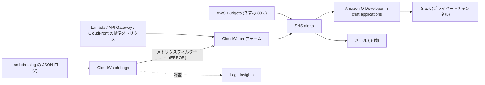

# Observability

[設計書](../architecture.md) の詳細。ログ・メトリクス・アラーム・通知の設計。

判断の理由: [ADR-0009](../adr/0009-observability.md)

CloudWatch の標準機能だけで構成し、無料枠に収める。外部のサービスと追加の SDK は使わない。

## Logs

- Go 標準の `log/slog` で JSON を出力する。Lambda のログ形式も JSON にする
- ログレベルは、Lambda が設定する環境変数 `AWS_LAMBDA_LOG_LEVEL` から読む
- 記録する項目: リクエスト ID・メンバー ID (Cognito の `sub`)・ルート・ステータス・処理時間・動画 ID
- 記録しない項目: トークン・Cookie・署名付き URL・メールアドレス・ファイル名
- ロググループの保持期間は 30 日 (Terraform で設定する)
- 削除などの操作は、実行したメンバーと対象を記録する。AWS の操作履歴は CloudTrail のイベント履歴 (標準で 90 日) で確認する

## Error Handling

| 状況 | レベル |
|---|---|
| 共通 middleware で `recover` した panic | ERROR (スタックトレースとリクエスト ID 付き) |
| 5xx を返す処理 | ERROR |
| 認証の失敗・サイズの不一致 | WARN |
| そのほかの 4xx | ERROR にしない |

- ブラウザ側のエラー (`window.onerror`・`unhandledrejection`・`htmx:responseError`) は `POST /api/client-log` に送る。`source=client` を付けて ERROR で記録する
- 調査には、保存した Logs Insights のクエリ `filter level = "ERROR" | pattern @message` を使う。似たエラーを自動でまとめる

## Metrics and Dashboard

- Lambda・API Gateway・CloudFront・S3・DSQL が自動で出すメトリクスを使う
- カスタムメトリクスは無料枠の 10 個以内にする
- ダッシュボードは 1 つにし、Terraform で定義する (無料枠は 3 つまで)

## Alarms and Notifications

アラームは無料枠の 10 個以内にする。

| 対象 | 条件の目安 |
|---|---|
| アプリの ERROR ログ (メトリクスフィルター `{ $.level = "ERROR" }`) | 5 分間に 1 件以上 |
| Lambda のエラー (タイムアウト・メモリ不足を含む) | 5 分間に 1 件以上 |
| API Gateway の 5xx | 5 分間に 1 件以上 |
| Lambda のスロットリング | 1 件以上 |
| Lambda の実行時間 | タイムアウトの 8 割に近づいた |
| AWS Budgets | 月額予算の 80% |
| 認証の失敗・4xx の急増 | 5 分間に通常の数倍 (値は運用しながら調整) |

- アラームと AWS Budgets の通知は、SNS トピック `alerts` に送る
- Slack ワークスペースの連携は、最初の 1 回だけコンソールで行う。以降のチャンネル設定は Terraform で管理し、ワークスペース ID とチャンネル ID は GitHub の Environment 変数から渡す
- アラームの説明欄に、保存した Logs Insights クエリへのリンクを書く
