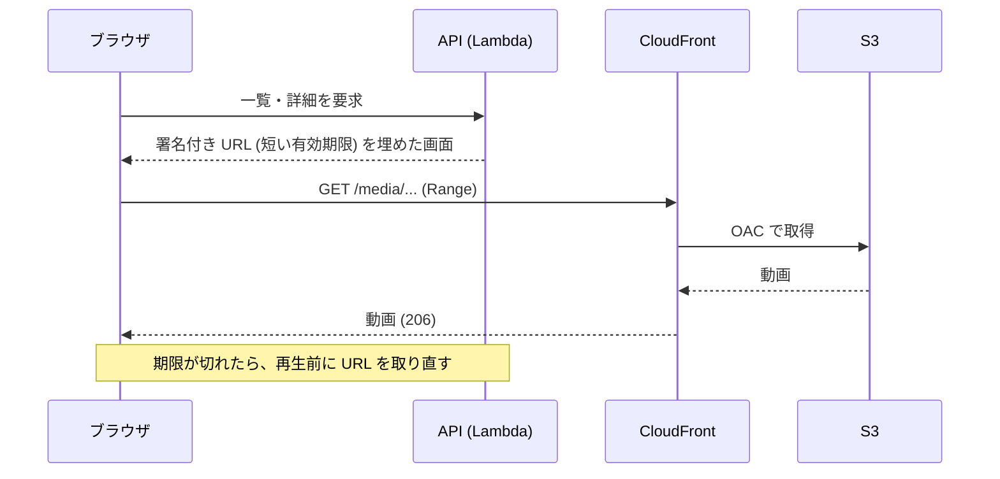

# Playback

[設計書](../architecture.md) の詳細。一覧・再生・ダウンロード・お気に入りの設計。

判断の理由: [ADR-0007](../adr/0007-video-storage-delivery.md)

## List

- 一覧は撮影日の古い順で、`(撮影日時, 動画 ID)` を基準にしたページングで少しずつ読み込む
- 月ごと・年ごとを切り替え、最初は今月 (年ごとなら今年) を表示する
- 月・年の範囲は日本時間で切り、UTC に直して検索する ([Data](data.md))
- 削除済みの動画は出さない

## Playback

- 署名は CloudFront の鍵で行い、秘密鍵は SSM Parameter Store に置く
- シークは HTTP の Range リクエストで行う。再生の開始時に、再読み込みなどの操作を求めない
- Service Worker (`/service-worker.js`) がキャッシュするのは画面の部品だけで、動画はキャッシュしない

## Download

- 一覧で複数の動画を選び、選んだ動画を 1 本ずつ順に保存する。ZIP にはせず、サーバー側でまとめる処理は持たない
- 動画ごとに署名付き URL を取り、元のファイルをそのまま取得して端末に保存する。保存させるための応答ヘッダー (Content-Disposition) の扱いは、実装時に決める
- 変換しないので、位置情報を含めて保存したときの内容のまま渡る

## Favorites

- お気に入りは家族ごとの記録で、ほかの家族の表示には影響しない
- お気に入りの一覧は、月・年に関係なく自分のお気に入りだけを、期間をまたいで表示する
- 並びは撮影日の新しい順。月・年の一覧と同じ基準のページングで読み込む
- 削除した動画は一覧に出さない
