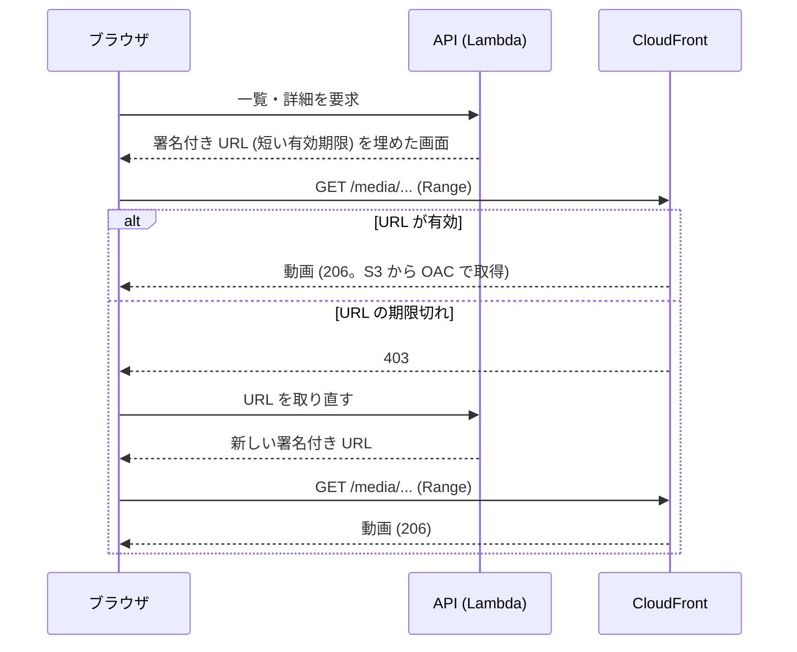

# Playback

[設計書](../architecture.md) の詳細。一覧・再生・ダウンロード・お気に入り。

判断の理由: [ADR-0019](../adr/0019-video-transfer.md)

## List

- 月ごと・年ごとを切り替え、最初は今月 (年ごとなら今年) を表示する
- 撮影日の古い順で、`(撮影日時, 動画 ID)` を基準にしたページングで少しずつ読み込む。削除済みは出さない
- 月・年の範囲は日本時間で切り、UTC に直して検索する

## Playback

- 署名の秘密鍵は SSM Parameter Store に置く
- Service Worker は画面の部品だけをキャッシュし、動画はキャッシュしない

## Download

- 一覧で複数の動画を選び、1 本ずつ順に、元のファイルのまま保存する。ZIP にはせず、サーバー側でまとめる処理は持たない
- 動画ごとに保存用の署名付き URL を取って取得する。URL に `response-content-disposition=attachment` を付け、端末に保存させる
- CloudFront は、このクエリ文字列をオリジン (S3) に渡す。再生用の URL とはキャッシュを分ける
- iOS の Safari で保存できるかは、リリース前に実機で確かめる ([Testing](testing.md))

## Favorites

- お気に入りは家族ごとで、ほかの家族の表示には影響しない
- 一覧は、月・年に関係なく自分のお気に入りだけを、撮影日の新しい順に並べる
