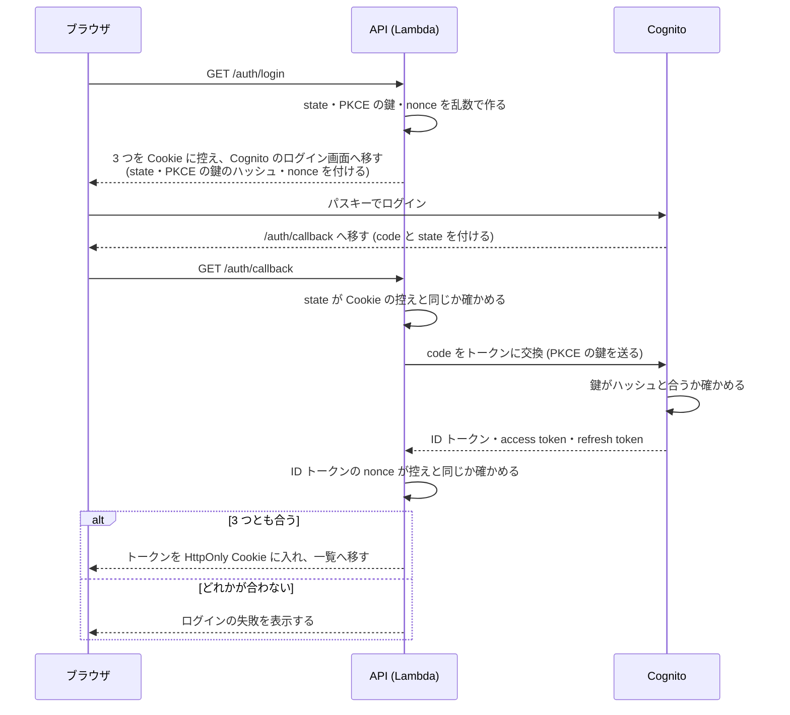
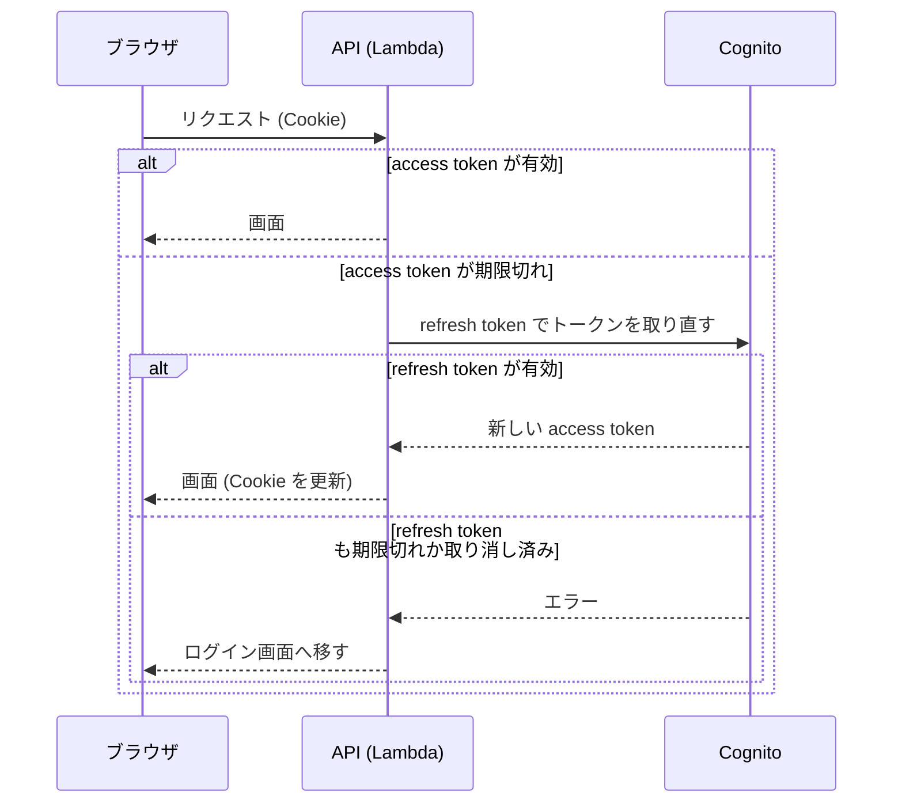

# Security

[設計書](../architecture.md) の詳細。認証・配信・権限・攻撃への対策。

判断の理由: [ADR-0009](../adr/0009-auth-cognito.md) / [ADR-0010](../adr/0010-login-passkey.md) / [ADR-0011](../adr/0011-session-cookie.md) / [ADR-0016](../adr/0016-entry.md) / [ADR-0019](../adr/0019-video-transfer.md) / [ADR-0021](../adr/0021-attack-protection.md) / [ADR-0020](../adr/0020-origin-lock.md) / [ADR-0030](../adr/0030-dev-no-geo-restriction.md)

## Authentication

### Login

| 値 | 防ぐこと |
|---|---|
| state | 攻撃者のアカウントの `code` を付けたリンクを踏ませ、攻撃者のアカウントでログインさせること (CSRF) |
| PKCE | 途中で盗まれた `code` を、攻撃者がトークンに交換すること |
| nonce | 古い ID トークンや盗まれた ID トークンを使い回すこと |

### Session

- Cognito で招待してアカウントを作る。自己サインアップは無効。パスキーが主で、予備はパスワードと TOTP
- ログイン状態は HttpOnly Cookie で保持する。JWT の検証と認可は Lambda で行う
- Cookie には access token (有効期限 15 分) と refresh token (30 日) を別々に入れる。access token が切れたら、Lambda が refresh token で取り直す。30 日を過ぎたら、パスキーでログインし直す
- メンバーから外すときは、Cognito のユーザーを無効にし、refresh token を取り消す。残った access token も 15 分以内に切れる
- ログインなしで通すのは `/auth/login`・`/auth/callback`・`/static/*` だけ。ほかはログイン画面へ飛ばし、DB には触れない

## Delivery

- S3 はパブリックアクセスをすべてブロックし、CloudFront の OAC からだけ読む
- 動画・サムネイルの配信とアップロードは、短い有効期限の署名付き URL だけ
- `/media/*` は `X-Content-Type-Options: nosniff` と `Content-Security-Policy: sandbox` を付けて配信する。アップロードされたファイルが、アプリと同じドメインでスクリプトとして動かないようにする
- Cookie は `Secure`・`HttpOnly`・`SameSite=Lax`。書き込みでは `HX-Request` ヘッダーと Origin を確認する (CSRF)
- 外部スクリプトは読み込まない。CSP・HSTS・`X-Content-Type-Options` を付け、htmx は `allowEval = false`
- `robots.txt` で全ページ Disallow し、`X-Robots-Tag: noindex` を付ける

## Permissions

- IAM は Lambda ごとに最小権限。DSQL へは IAM 認証で、対象のクラスターだけに絞る
- ルートユーザーは MFA を設定し、普段は使わない。通知のロールは CloudWatch の読み取りだけ

## Attack Protection

WAF は使わず、地域制限 → スロットリング → オリジン検証 → 予約同時実行数で防ぐ。

| 対象 | prod | dev |
|---|---|---|
| ステージ全体 (レート/秒・バースト) | 10・20 | 5・10 |
| `POST /api/uploads` | 2・5 | 2・5 |
| `POST /api/client-log` | 1・3 | 1・3 |
| Lambda の予約同時実行数 | 5 | 2 |

- 見積もり: 家族が同時に一番忙しい操作 (スクロール・アップロード) をしても、1 秒に 4〜8 件ほど。動画とサムネイルは CloudFront から配るので、API を通らない
- 同時実行数は「1 秒あたりの件数 × 1 件の処理時間」。10 件/秒で 1 件 0.5 秒かかっても 5 で足りる
- 超えたら `429` と `Retry-After` を返し、画面に再試行を促す
- 値の確かめ方: dev で負荷をかけ、上限で `429` が返ることと、普段の操作で当たらないことを確かめる。使い始めたら CloudWatch で、API Gateway の `Count`・`4xx` と、Lambda の `ConcurrentExecutions`・`Duration`・`Throttles` の最大を見て直す
- `POST /api/client-log` は、Lambda 内のトークンバケットとサイズの上限でも制限する
- ログインの総当たりは、Cognito のロック機能 (5 回の失敗で 1 秒、失敗のたびに倍、最大約 15 分) で防ぐ
- CloudFront の地域制限で、prod は `JP` だけを許可する。dev は地域制限をかけない (GitHub のランナーからスモークテストと E2E を通すため。[ADR-0030](../adr/0030-dev-no-geo-restriction.md))
- CloudFront がオリジンへ付ける `X-Origin-Verify` を、Lambda の middleware が最初に検証し、不一致は `403`。API Gateway の URL への直接アクセスで、地域制限を回避されない。値は SSM Parameter Store に置き、定期的に入れ替える。入れ替えの間は新旧どちらの値も受け付け、CloudFront の切り替えが終わってから古い値を消す
- 海外旅行のときは、Terraform で旅行先の国を一時的に許可する。iCloud プライベートリレーが日本と判定されるかを、リリース前に確認する
