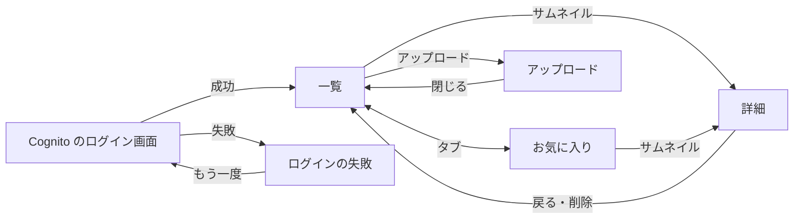

# UI

[設計書](../architecture.md) の詳細。画面の一覧・遷移・画面ごとの要素と状態。

判断の理由: [ADR-0002](../adr/0002-client-web.md) / [ADR-0004](../adr/0004-mpa.md) / [ADR-0008](../adr/0008-htmx.md)

## Screens

| 画面 | 内容 |
|---|---|
| 一覧 | 月ごと・年ごとの動画の一覧。最初の画面 |
| お気に入り | 自分のお気に入りだけの一覧 |
| 詳細 | 1 本の動画の再生と操作 |
| アップロード | 動画を選んで送り、進み具合を見る |
| ログインの失敗 | ログインに失敗したときの案内 |

ログインの画面は Cognito が用意する画面を使い、自分では作らない ([Security](security.md))。

## Transitions



- 画面の切り替えは htmx で中身だけを差し替え、URL も書き換える。URL を直接開いても同じ画面になる
- ログインが切れていたら、どの画面からも Cognito のログイン画面へ移す

## List

```
┌──────────────────────────────┐
│ [一覧] [お気に入り]   [＋送る] │
│ [月 | 年]   ◀ 2026年11月 ▶    │
│ ┌────┐ ┌────┐ ┌────┐         │
│ │ ▶  │ │ ▶  │ │ ▶  │         │
│ └1:23┘ └0:45┘ └3:10┘         │
│  11/2   11/3   11/3          │
│ ┌────┐ ┌────┐ ┌────┐         │
│ │ ▶  │ │ ▶  │ │ ▶  │         │
│ └────┘ └────┘ └────┘         │
│ [選択]                       │
└──────────────────────────────┘
```

- 月ごと・年ごとを切り替え、◀ ▶ で前後の月・年へ移る。最初は今月 (年ごとなら今年)
- サムネイル・再生時間・撮影日を、撮影日の古い順に並べる。下までスクロールすると続きを読み込む
- [選択] で選ぶ状態にし、選んだ動画を 1 本ずつ順に保存する。保存中は「3 / 10 本目を保存中」のように進み具合を出す

| 状態 | 表示 |
|---|---|
| 空 | 「この月の動画はありません」と、アップロードへの案内 |
| 読み込み中 | サムネイルの枠だけを先に出す |
| エラー | 「読み込めませんでした」と [もう一度] |

## Favorites

- 一覧と同じ並べ方で、月・年に関係なく、自分のお気に入りだけを撮影日の新しい順に並べる
- 空のときは「お気に入りはまだありません」と出す

## Detail

```
┌──────────────────────────────┐
│ ◀ 戻る                        │
│ ┌──────────────────────────┐ │
│ │                          │ │
│ │        動画 (再生)        │ │
│ │                          │ │
│ └──────────────────────────┘ │
│ 2026年11月3日 14:05  3:10     │
│ [☆ お気に入り] [保存] [削除]   │
└──────────────────────────────┘
```

- 動画は Safari の標準のプレーヤーで再生し、見たい位置へ移れる
- [☆ お気に入り] は押すたびに登録と解除を切り替え、その場で表示を変える
- [保存] は元のファイルのまま端末に保存する
- [削除] は確認してから削除し、一覧へ戻る。誰がアップロードした動画でも削除できる

## Upload

```
┌──────────────────────────────┐
│ 動画を送る              [閉じる] │
│ [動画を選ぶ]                   │
│ IMG_0012.MOV  送信中 ███░ 72%  │
│ IMG_0013.MOV  送信中 █░░░ 20%  │
│ IMG_0014.MOV  待機中           │
│ IMG_0011.MOV  失敗   [再送]    │
│ IMG_0010.MOV  完了 ✓           │
└──────────────────────────────┘
```

- 複数の動画をまとめて選べる。同時に送るのは 2 本までで、ほかは待機中にする ([Upload](upload.md))
- 動画ごとに 待機中・送信中 (進み具合)・完了・失敗 を出し、失敗した動画だけ [再送] できる
- 中断して戻ってきたら、「続きから送ります」と出して、送り終えた分の続きから再開する
- 送信中に閉じようとしたら、送信が止まることを確認する

## Common

- iPhone の Safari の縦向きを前提にする ([ADR-0003](../adr/0003-support-safari.md))
- 混み合って断られたとき (`429`) は、「しばらく待ってから送り直します」と出して自動で再試行する
- 通信が切れたときは「通信が切れています」と出す
