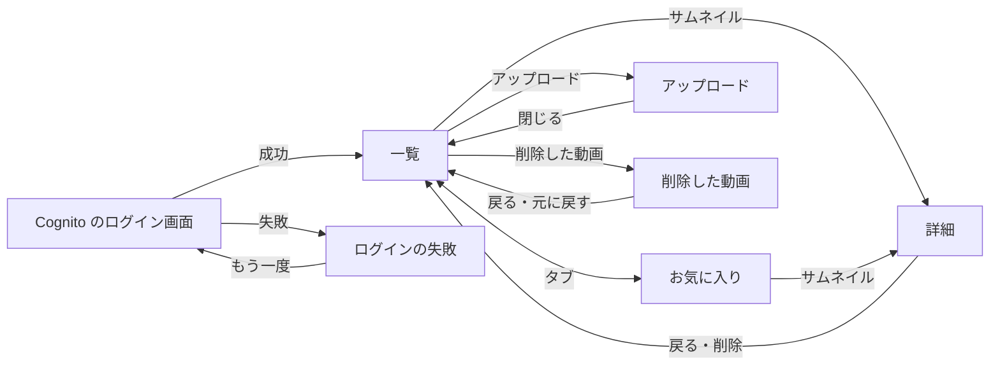

# UI

[設計書](../architecture.md) の詳細。画面の一覧・遷移・画面ごとの要素と状態。

判断の理由: [ADR-0002](../adr/0002-client-web.md) / [ADR-0004](../adr/0004-mpa.md) / [ADR-0008](../adr/0008-htmx.md)

## Screens

| 画面 | 内容 |
|---|---|
| 一覧 | 月ごと・年ごとの動画の一覧。最初の画面 |
| お気に入り | 自分のお気に入りだけの一覧 |
| 詳細 | 1 本の動画の再生と操作 |
| アップロード | 動画を選んで送り、進み具合を見る |
| 削除した動画 | 削除から 30 日以内の動画の一覧。ここから元に戻す |
| ログインの失敗 | ログインに失敗したときの案内 |
| エラー | ページを出せないときの案内 ([Errors](#errors)) |

ログインの画面は Cognito が用意する画面を使い、自分では作らない ([Security](security.md))。

## Transitions

- 画面の切り替えは htmx で中身だけを差し替え、URL も書き換える。URL を直接開いても同じ画面になる
- ログインが切れていたら、どの画面からも Cognito のログイン画面へ移す

## List

- 月ごと・年ごとを切り替え、ボタンで前後の月・年へ移る。最初は今月 (年ごとなら今年)
- サムネイル・再生時間・撮影日を、撮影日の古い順に並べる。下までスクロールすると続きを読み込む
- [選択] で選ぶ状態にし、選んだ動画を 1 本ずつ順に保存する。保存中は「3 / 10 本目を保存中」のように進み具合を出す

| 状態 | 表示 |
|---|---|
| 空 | 「この月の動画はありません」と、アップロードへの案内 |
| 読み込み中 | サムネイルの枠だけを先に出す |
| エラー | 「読み込めませんでした」と [もう一度] |

## Favorites

- 一覧と同じ並べ方で、月・年に関係なく、自分のお気に入りだけを撮影日の新しい順に並べる
- 空のときは「お気に入りはまだありません」と出す

## Detail

- 動画は Safari の標準のプレーヤーで再生し、見たい位置へ移れる
- [☆ お気に入り] は押すたびに登録と解除を切り替え、その場で表示を変える
- [保存] は元のファイルのまま端末に保存する
- [削除] は確認してから削除し、一覧へ戻る。誰がアップロードした動画でも削除できる

## Upload

- 複数の動画をまとめて選べる。同時に送るのは 2 本までで、ほかは待機中にする ([Upload](upload.md))
- 動画ごとに 待機中・送信中 (進み具合)・完了・失敗 を出し、失敗した動画だけ [再送] できる
- 中断して戻ってきたら、「続きから送ります」と出して、送り終えた分の続きから再開する
- 送信中に閉じようとしたら、送信が止まることを確認する

## Deleted Videos

- 削除から 30 日以内の動画を、削除した日の新しい順に並べる。誰が削除した動画でも出す
- 動画ごとに、サムネイル・撮影日・完全に消えるまでの日数 (「あと 12 日」など) を出す
- [元に戻す] を押すと、すぐに通常の一覧へ戻る。確認は出さない (戻す操作は取り消せるため)
- 30 日を過ぎた動画は、完全に削除されて画面から消える ([Data](data.md))
- 空のときは「削除した動画はありません」と出す

## Errors

ページそのものを出せないときの画面。画面の中で一部が読み込めないときは、ページを差し替えずに、その場に「読み込めませんでした」と出す。

| エラー | 起きる場面 | 画面に出す内容 | 返すところ |
|---|---|---|---|
| 404 | 消された動画の URL を開いた・URL の打ち間違い | 「動画が見つかりません」と [一覧へ] | Lambda |
| 500 | サーバーの不具合 | 「問題が起きました。しばらくしてからお試しください」と [もう一度] | Lambda (panic も middleware で拾う) |
| 503 | Lambda の同時実行数の上限・API Gateway の障害 | 500 と同じ内容 | CloudFront のエラーページ |
| 403 (地域外) | 海外から開いた | 「日本国内からだけ使えます」 | CloudFront のエラーページ |
| オフライン | 電波がない状態で開いた | 「通信が切れています」と [もう一度] | Service Worker |

- Lambda に届かない失敗 (503・地域外) は、CloudFront のカスタムエラーレスポンスで、S3 に置いた静的な HTML を返す
- オフラインの画面は、Service Worker が静的な HTML を控えておき、通信できないときに返す

## Common

- iPhone の Safari の縦向きを前提にする ([ADR-0003](../adr/0003-support-safari.md))
- 混み合って断られたとき (`429`) は、「しばらく待ってから送り直します」と出して自動で再試行する
- 通信が切れたときは「通信が切れています」と出す
