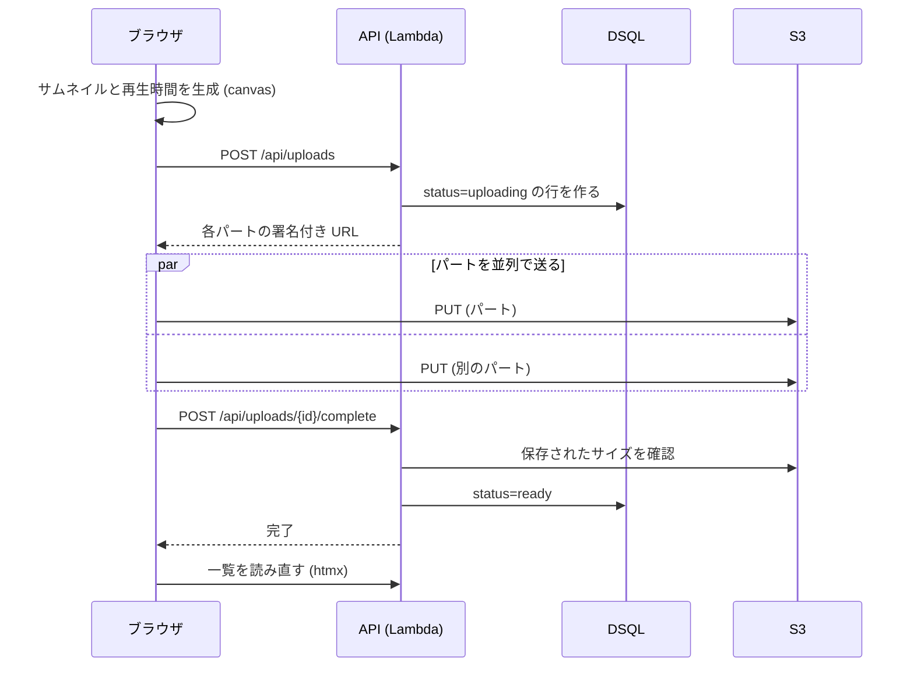

# Upload

[設計書](../architecture.md) の詳細。アップロードとその再開の設計。

判断の理由: [ADR-0007](../adr/0007-video-storage-delivery.md)

## Flow

## Details

- 動画は圧縮・変換せず、元の形式のまま保存する
- サムネイルと再生時間は端末側で作る。サムネイルは canvas で作り直すので、位置情報などの付随情報を含まない
- アップロード用の署名付き URL は、サーバーが決めたキーにだけ、短い有効期限で発行する
- 複数の動画は同時に 2 本まで送る
- 完了時に確認するのは、申告されたサイズと実際のサイズの一致だけ。一致しなければ WARN で記録し、失敗として扱う
- 動画ごとの状態は 待機中・送信中・完了・失敗 の 4 つ。失敗した動画だけを再送できる
- 1 本あたり・利用者ごとの本数と容量に上限は設けない

## Resume

- 中断しても、送信済みのパートを S3 に残し、IndexedDB に保存した進捗から続きを送る。再開時は未送信のパートの署名付き URL を取り直す
- iOS でファイルを選び直すと前の選択が消えるので、選択が終わった時点で JS のリストにファイルをコピーしておく
- 完了しなかったマルチパートアップロードは、ライフサイクルルールで 7 日後に自動削除する
