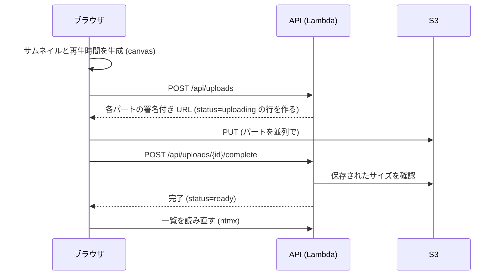
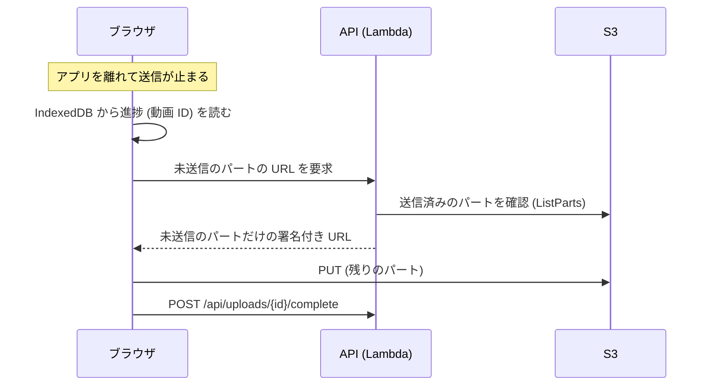
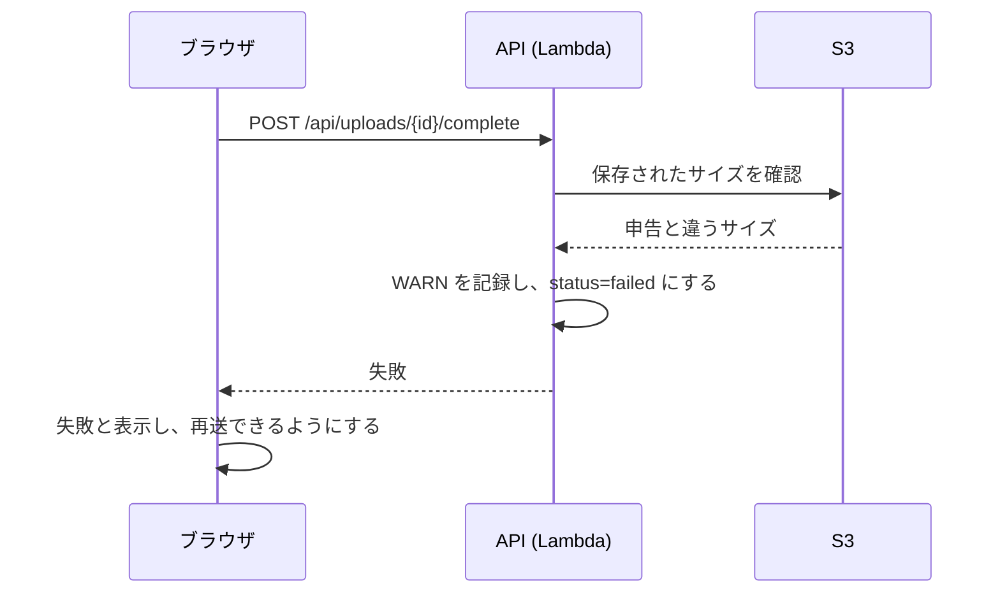
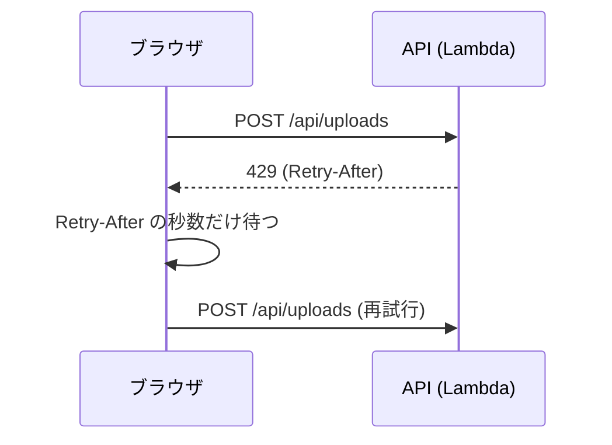

# Upload

[設計書](../architecture.md) の詳細。アップロードと再開。

判断の理由: [ADR-0019](../adr/0019-video-transfer.md)

## Upload

- 動画は 10 MB ほどの「パート」に分けて送り、S3 が最後に 1 つのファイルに組み立てる (S3 のマルチパートアップロード)
- 動画は圧縮・変換せず、元の形式のまま保存する。1 本あたり 10 GB までで、利用者ごとの本数と容量に上限は設けない
- サムネイルは canvas で作り直すので、位置情報を含まない
- 署名付き URL は、サーバーが決めたキーにだけ、短い有効期限で発行する
- Content-Type は、サーバーがアップロードの開始時に決める (`video/mp4`・`video/quicktime`・`image/jpeg`)。ほかの種類は受け付けず、ブラウザからは変えられない
- 同時に送る動画は 2 本まで。状態は 待機中・送信中・完了・失敗 で、失敗した動画だけ再送できる
- 完了時に確認するのは、申告されたサイズと実際のサイズの一致だけ。不一致は WARN で記録して失敗にする
- 中断したら、S3 に残した送信済みパートと IndexedDB の進捗から再開する。未送信パートの URL は取り直す
- iOS でファイルを選び直すと前の選択が消えるので、選択後に JS のリストへコピーしておく
- 完了しなかったマルチパートは、ライフサイクルルールで 7 日後に削除する

## Failures

正常系の図のうち、失敗した手順から描く。

### 中断と再開

### サイズの不一致

### 混み合ったとき (429)

